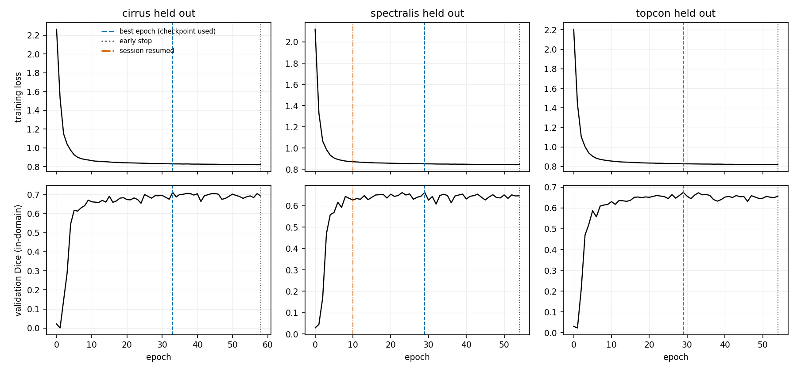
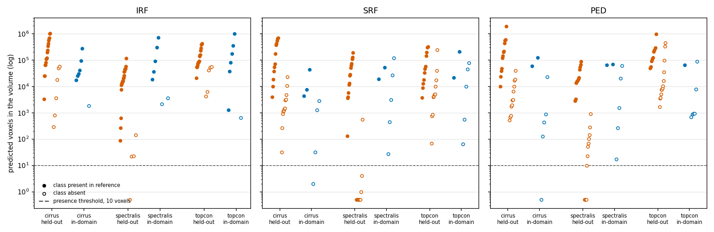
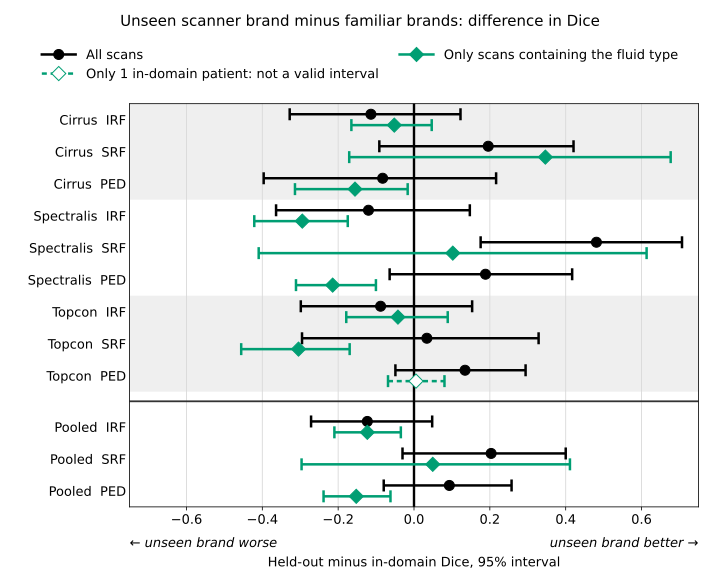
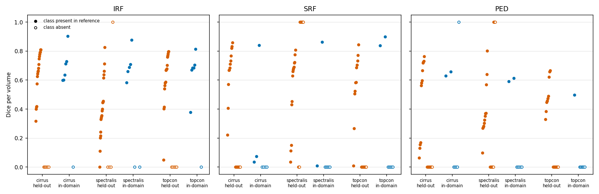
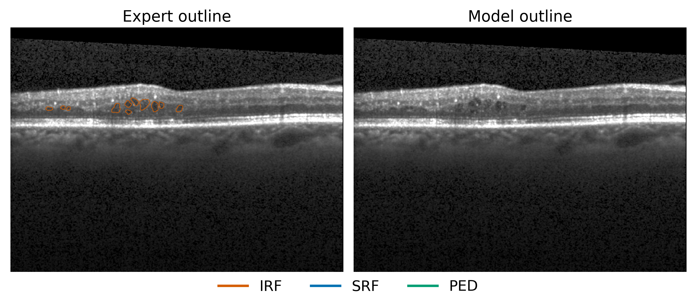
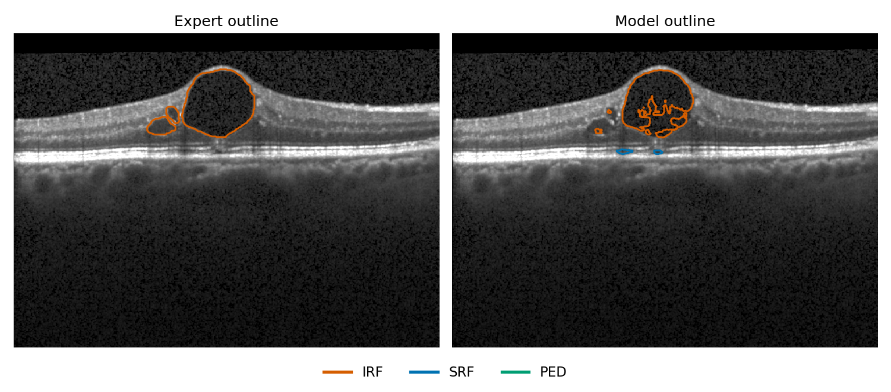
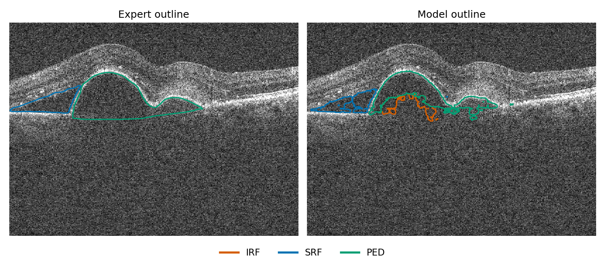
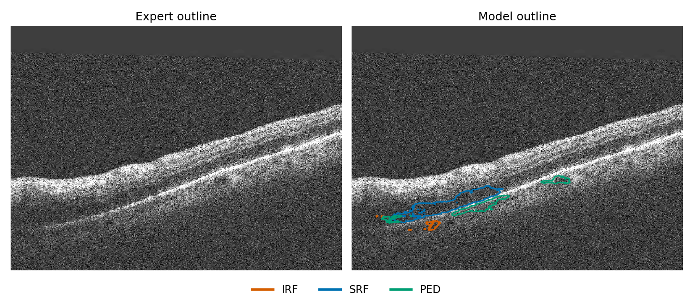
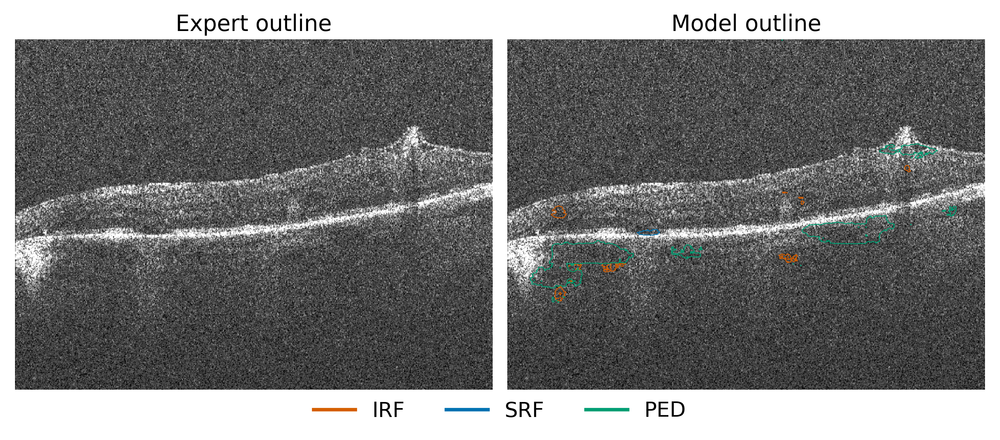

<!--
Document: Analytical Validation Report
Status: DRAFT v0.7 — final figures from the `docs/07` §17.13 re-evaluation after the audit of 2026-10-28 (2026-10-30); earlier figures kept in §10, the audit summarised in §11
Owner: Anurag Yadav
Last reviewed: 2026-10-30
Change history: docs/13_change_control_log.md
-->

# Analytical Validation Report

> **Every figure in §1–§9 comes from the final re-evaluation of `docs/07` §17.13 (2026-10-30),
> run after the audit of 2026-10-28** (§11; `docs/08` §5k). The audit found twelve defects. Two
> changed what an evaluation measures: the inversion placed every prediction about one native row
> too deep (D1), and the detection score's maximum ran over the padding (D4). Both were fixed, the
> same models, checkpoints, threshold, passes and bootstrap were used, and every bucket was
> evaluated again, gated on an unchanged population and reference. **No Dice moved by more than
> 0.0072 in any arm, no HD95 by more than 0.0298 mm, and no detection figure at all; which
> comparisons establish a difference is unchanged.**

> **Earlier figures are kept in §10, labelled, because the record states what happened.** §10.1:
> measured through the defective inversion of 2026-10-16 (`docs/13`). §10.2: HD95 measured with the
> voxel spacing on the wrong axes (`docs/13`, finding of 2026-10-25). §10.3: the §17.12 figures,
> which this report carried until 2026-10-30, measured through D1 and, for AUROC, D4. None of them
> is a result.

> **Every per-fold figure in this document is copied from the committed record of the run that
> produced it**: `docs/08` §5k, built from the final evaluation records under `artifacts/`,
> and `docs/08` §5c–§5g for the training runs. The pooled, class-present and
> difference figures of §5 are computed from the same records by the code that computed their
> earlier versions (`scripts/07_make_figures.py`, `per_patient` and `difference`). Each figure
> is labelled with its standing:
>
> - **Primary, pre-registered:** fixed in `docs/07` §17 (with §17.7 and §17.10) before the
>   data it describes was seen.
> - **Secondary, pre-registered:** `docs/07` §19, declared before spectralis or topcon was
>   evaluated.
> - **Post-hoc:** declared after the results it touches were visible.
>
> A reader can tell them apart from the label alone (`docs/07` §19.4), without reconstructing
> the chronology.
>
> **Figures 1–5 add no result.** They are drawn from the same records by
> `scripts/07_make_figures.py`, which refuses to draw if a per-fold Dice interval differs from
> its stored record, a pooled interval from the §5.2 table, or a difference interval from the
> §5.4 table (`07_make_figures.py:98-163`). They are drawn from the final records. Their captions are generated with them
> (`docs/figures/captions.md`) and reproduced here unchanged.
>
> **Figures 6–11 add no result either.** They are illustrative B-scans (§7.4), chosen by the
> rule of `docs/07` §21 from the final records and drawn from the label maps the final run saved
> (§21.11), each checked by checksum and saved only after its re-measured Dice and voxel counts
> equalled its record exactly. Their captions come from `docs/figures/illustrations.md`,
> generated by `scripts/09_illustrative_bscans.py`, and are reproduced here unchanged after the
> figure number. Three passages are the author's, in Figures 6, 7 and 8 (`docs/07` §21.8,
> §21.9, §21.11).

## Summary

**The pre-registered question** (`docs/07` §17.1 and §17.7(c); the leave-one-vendor-out design
is described in `docs/06` §6): when a fluid-segmentation model is trained on two OCT vendors, how
much worse does it perform on the third, unseen vendor? The comparison is against unseen patients
from the vendors it was trained on.

**Headline — primary, pre-registered.** By the pre-registered criterion, the overlap of the two
arms' 95% intervals, **one of nine comparisons establishes a difference in Dice: spectralis SRF,
where the unseen vendor scores higher**, 0.6088 [0.4587, 0.7519] n=24, against 0.1268 [0.0000, 0.3779] n=7 for unseen patients of the training vendors. Beside it:

- the in-domain arm is 71% SRF-absent (5 of 7 volumes), and all 5 of those volumes scored Dice
  0, because the model marks some SRF where there is none (the false-positive pattern of §7.1);
  on the held-out side, 7 of the 10 SRF-absent volumes scored Dice 1;
- restricted to volumes containing SRF, the same comparison's difference interval includes
  zero: +0.0999 [−0.4211, +0.6199];
- no multiplicity correction was pre-registered for the nine comparisons.

The difference is consistent with case mix; this report does not claim that case mix explains
it. **No degradation on an unseen vendor is established by the pre-registered criterion**, in
any fold or class. The other eight comparisons establish no difference in either direction.

**Post-hoc, restricted to volumes containing the fluid.** Bootstrapping the held-out −
in-domain difference directly and pooling over folds, the IRF and PED intervals exclude zero
with the held-out vendor lower: IRF −0.1268 [−0.2030, −0.0463] (55 held-out against 11
in-domain patients), PED −0.1571 [−0.2474, −0.0617] (33 against 3). Of all 24 difference
intervals, 7 exclude zero, and 6 of those 7 have the held-out vendor lower. They are
uncorrected, chosen after the results were visible, and PED's in-domain arm is 3 patients:
**suggestive, not established.**

**The primary and class-present views point in opposite directions on the same data, because
of the empty-scan convention.** A volume without a fluid type scores Dice 1 if nothing is
predicted and 0 if anything is (§5.2). The primary, all-volume view includes those volumes. The
arms differ both in how many such volumes they hold and in how often the model predicts nothing
on them, which can raise one arm and lower the other. The class-present view removes those
volumes and compares segmentation only where there is fluid to segment. Neither view corrects
the other: the first is the pre-registered result, the second is post-hoc.

**What the study could detect** (post-hoc, §5.4, derived from directly bootstrapped difference
intervals). An observed difference must exceed half the interval's width to exclude zero:

- **per fold:** 0.18–0.32 Dice;
- **pooled across folds:** 0.14–0.20 Dice.

A true difference of that size would be detected only about half the time. **Differences
smaller than about 0.14 Dice cannot be detected by this design**, and per-fold differences
below about 0.3 are detected unreliably. **The main limitation is the in-domain arms: 7
patients per fold**, which leaves their Dice intervals 0.21–0.52 wide.

**The design removed the most obvious vendor signature on purpose.** Per-volume intensity
normalisation took out the Topcon brightness offset, a detector pedestal perfectly correlated
with vendor. So the absence of a detectable gap may partly reflect that choice, and every gap
here is a lower bound on the raw-data gap (§8.1).

**Further findings, in order of weight.**

1. **False positives in class-absent volumes dominate the all-volume Dice** (§7.1; secondary,
   pre-registered except for cirrus, where it is post-hoc). In 14 of 18 fold × arm × class
   cells, every class-absent volume scored Dice 0: the model predicted some of the class where
   there was none. This also **confounds vendor with case mix** (§5.2, post-hoc). The
   in-domain arms carry more class-absent volumes than the held-out arms, 62% against 47% for
   SRF and 77% against 53% for PED, pooled, so their all-volume Dice is pulled down harder.
2. **The metric is fragile in small arms** (§7.2). One model's in-domain SRF Dice moved by 0.1431
   between two equally valid MC-dropout draws, both measured through the defect. One
   class-absent volume flipping between Dice 1 and 0 moves a 7-patient mean by 1/7 = 0.1429. The
   record that would confirm this mechanism does not exist.
3. **The pooled comparison** (§5.1–§5.3; post-hoc pooling rule). Pooled over folds with the
   patient as the unit (70 held-out against 13 in-domain), all three classes overlap on all
   volumes. On class-present volumes alone, IRF and SRF overlap and PED does not, with the
   held-out vendor lower and an in-domain arm of 3 patients.

**What this report does not claim.** It does not claim that the model generalises to unseen
vendors, nor that it generalises better or worse than in domain. It does not claim the absence
of a vendor effect: the post-hoc class-present view points towards one, and the design cannot
see a difference smaller than its detection limit.

## 1. Objective

Quantify the cross-vendor generalisation of retinal OCT fluid segmentation (IRF, SRF, PED).
Train on two vendors, evaluate on the third, and compare against unseen patients of the
training vendors. Report every figure per class, per vendor, with a patient-level 95% interval
and its `n` (`docs/07` §17.2).

## 2. Method

| Element | As run | Defined in |
|---|---|---|
| Data | RETOUCH training partition, 70 volumes, one per patient: cirrus 24, spectralis 24, topcon 22 | `docs/06` §1, §3.1 |
| Folds | leave-one-vendor-out: held-out vendor = `test`; per fold, `val` and an in-domain reference of 7 patients each, drawn from the training vendors | `docs/06` §6, `configs/folds/` |
| Model | 2-D UNet, instance norm, dropout 0.2; checkpoint selected on in-domain `val` only: cirrus epoch 33, spectralis 29, topcon 29 | `docs/08` §5c, §5e, §5f |
| Inference | mean of 20 MC-dropout passes, **seeded per volume**, deterministic kernels; predictions inverted to native geometry before measurement, padding removed first (the corrected inversion) | SRS-029, SRS-091, SRS-074 |
| Metrics | Dice and HD95 (max of directed, mm) per class. Detection is derived from the segmentation: present when predicted voxels > 10; AUROC from the MC mean probability | `docs/07` §17.2, §17.7a |
| Intervals | patient-level bootstrap, 2000 resamples, α = 0.05, seed 20260916. HD95 drops volumes where exactly one of prediction and reference is empty, so its `n` can be smaller | SRS-087, `docs/07` §17.3 |
| Gap | in-domain − held-out, **a point difference with no interval**: the two arms are bootstrapped separately | `docs/07` §17.2 |
| Sealed access | each `test` and `in_domain_ref` bucket evaluated once under the seeded procedure, then again after the inversion fix (§17.11), the HD95 fix (§17.12) and the audit (§17.13). Cirrus also has an earlier unseeded draw, kept and labelled (§3.1) | `docs/07` §17.10–§17.13; `docs/08` §5g.1, §5i.1, §5j.1, §5k.1 |
| Re-evaluation | 2026-10-24, at `5422913`, after the inversion fix `3c085a1`: same models, checkpoints, threshold, seeded passes, metrics and bootstrap. Superseded by §17.13; the earlier figures are in §10 | `docs/07` §17.11, `docs/08` §5i |
| HD95 re-evaluation | 2026-10-26, at `682dd3e`, after the HD95 spacing fix: the six sealed buckets again, each gated to stop unless everything but HD95 equalled the 24 October record. All six gates passed. Superseded by §17.13; these figures are in §10.3, the wrong-axes ones in §10.2 | `docs/07` §17.12, `docs/08` §5j |
| Final re-evaluation | 2026-10-29/30, after the audit's fixes of D1 (inversion row placement) and D4 (detection score over the padding): every bucket, `val` included, each gated to stop unless the population and the reference equalled its previous record; all nine gates passed. Every label map measured was saved, with checksums in the record (SRS-106). **Every figure in §1–§9 comes from these records** | `docs/07` §17.13, `docs/08` §5k |
| Reproducibility | two seeded evaluations of the open `val` bucket were IDENTICAL on every one of 466 compared values before any unlock, at the evaluation commit and again at each re-evaluation commit; at §17.13 the comparison also covered every saved label map's checksum | `docs/08` §5g.1, §5i.1; HAZ-016, RC-032 |

`docs/07` §17.5 names the comparison arm as "in-domain validation"; the arm pre-registered for
the headline comparison is the in-domain reference (§17.7(c)), and that is the arm used
throughout.

**Figure 1. Training loss and in-domain validation Dice per fold.** From each fold's `epochs.jsonl` (cirrus: 59 epochs, best 33, stopped after 58; spectralis: 55 epochs, best 29, stopped after 54; topcon: 55 epochs, best 29, stopped after 54). Every fold ended by early stopping, after 25 epochs without improvement. The checkpoint evaluated is the best epoch, chosen on in-domain validation only (§17.1). The dash-dot line marks where the spectralis run was resumed after an external interruption (`docs/08` D8). Validation Dice here is a training record, a point value with no interval, and is not a result.

## 3. Results — segmentation (primary, pre-registered)

**Gap convention:** for Dice, a positive gap means worse on the unseen vendor. For HD95, where
lower is better, a positive gap means the in-domain arm is worse. `n` is patients.

| Held-out vendor (trained on) | Class | Held-out Dice | In-domain reference Dice | Gap | Intervals overlap |
|---|---|---|---|---|---|
| cirrus (spectralis + topcon) | IRF | **0.4855** [0.3596, 0.6024] n=24 | **0.6022** [0.3812, 0.7626] n=7 | +0.1167 | yes |
| cirrus (spectralis + topcon) | SRF | **0.3302** [0.2009, 0.4754] n=24 | **0.1377** [0.0048, 0.3768] n=7 | -0.1925 | yes |
| cirrus (spectralis + topcon) | PED | **0.2408** [0.1244, 0.3655] n=24 | **0.3281** [0.0925, 0.6138] n=7 | +0.0873 | yes |
| spectralis (cirrus + topcon) | IRF | **0.3857** [0.2912, 0.4936] n=24 | **0.5039** [0.2499, 0.7284] n=7 | +0.1182 | yes |
| spectralis (cirrus + topcon) | SRF | **0.6088** [0.4587, 0.7519] n=24 | **0.1268** [0.0000, 0.3779] n=7 | -0.4820 | **no** |
| spectralis (cirrus + topcon) | PED | **0.3589** [0.2202, 0.5078] n=24 | **0.1749** [0.0000, 0.3614] n=7 | -0.1841 | yes |
| topcon (cirrus + spectralis) | IRF | **0.4760** [0.3433, 0.5951] n=22 | **0.5696** [0.3510, 0.7316] n=7 | +0.0936 | yes |
| topcon (cirrus + spectralis) | SRF | **0.2887** [0.1511, 0.4213] n=22 | **0.2509** [0.0000, 0.5216] n=7 | -0.0379 | yes |
| topcon (cirrus + spectralis) | PED | **0.2105** [0.1011, 0.3283] n=22 | **0.0721** [0.0000, 0.2162] n=7 | -0.1385 | yes |

| Held-out vendor (trained on) | Class | Held-out HD95 (mm) | In-domain reference HD95 (mm) | Gap | Intervals overlap |
|---|---|---|---|---|---|
| cirrus (spectralis + topcon) | IRF | 0.7570 [0.2980, 1.3079] n=18 | 0.5150 [0.0675, 0.9750] n=6 | -0.2420 | yes |
| cirrus (spectralis + topcon) | SRF | 0.5969 [0.1663, 1.1264] n=12 | 1.6409 [0.0360, 3.3660] n=3 | +1.0440 | yes |
| cirrus (spectralis + topcon) | PED | 0.9669 [0.4621, 1.5286] n=12 | 0.0709 [0.0000, 0.1189] n=3 | -0.8960 | **no** |
| spectralis (cirrus + topcon) | IRF | 0.5303 [0.3576, 0.7463] n=21 | 0.3989 [0.0543, 1.0630] n=5 | -0.1315 | yes |
| spectralis (cirrus + topcon) | SRF | 0.4345 [0.1550, 0.8228] n=21 | 0.8362 [0.0469, 1.6254] n=2 | +0.4017 | yes |
| spectralis (cirrus + topcon) | PED | 0.3469 [0.1828, 0.5478] n=16 | 0.8728 [0.0940, 1.6516] n=2 | +0.5259 | yes |
| topcon (cirrus + spectralis) | IRF | 1.3029 [0.7720, 1.9432] n=17 | 0.5161 [0.0917, 1.3107] n=6 | -0.7868 | yes |
| topcon (cirrus + spectralis) | SRF | 1.6563 [0.9280, 2.5078] n=11 | 1.7394 [1.0890, 2.3898] n=2 | +0.0831 | yes |
| topcon (cirrus + spectralis) | PED | 0.9720 [0.5200, 1.4186] n=9 | 1.6928 (single patient, no spread) n=1 | +0.7208 | **no** |

**Dice:** the held-out and in-domain intervals overlap: 8 of 9 comparisons. The point
differences point both ways, worse on the unseen vendor in 4 of 9 and better in 5 of 9.
**HD95: two do not overlap**, cirrus PED and topcon PED, and their in-domain arms hold **3** and
**1** patients. An interval over one patient has no spread, so nothing is concluded from either.
With the spacing on the wrong axes (§10.2), the same two comparisons did not overlap and every
gap pointed the same way, but against the §17.12 figures (§10.3) the values were larger in 17
of the 18 arms, by up to 5.6 times (topcon in-domain SRF), and smaller in one (cirrus in-domain
PED, 0.34 times); derived from those two sets of records.

**HD95 without both-empty volumes — secondary** (SRS-104, added after the audit, finding D3).
The pre-registered HD95 above scores a volume whose prediction and reference are both empty as
0 mm and averages it in, which pulls a mean towards 0 in proportion to the class-absent case
mix. The table below leaves those volumes out. It is **secondary, not pre-registered**, and the
primary HD95 above is unchanged.

| HD95 | Held-out vendor (trained on) | Class | Held-out HD95 (mm) | In-domain reference HD95 (mm) | Gap | Intervals overlap |
|---|---|---|---|---|---|---|
| secondary | cirrus (spectralis + topcon) | IRF | 0.7570 [0.2980, 1.3079] n=18 | 0.5150 [0.0675, 0.9750] n=6 | -0.2420 | yes |
| secondary | cirrus (spectralis + topcon) | SRF | 0.5969 [0.1663, 1.1264] n=12 | 1.6409 [0.0360, 3.3660] n=3 | +1.0440 | yes |
| secondary | cirrus (spectralis + topcon) | PED | 0.9669 [0.4621, 1.5286] n=12 | 0.1064 [0.0938, 0.1189] n=2 | -0.8605 | **no** |
| secondary | spectralis (cirrus + topcon) | IRF | 0.5569 [0.3853, 0.7770] n=20 | 0.3989 [0.0543, 1.0630] n=5 | -0.1580 | yes |
| secondary | spectralis (cirrus + topcon) | SRF | 0.6517 [0.2678, 1.1457] n=14 | 0.8362 [0.0469, 1.6254] n=2 | +0.1844 | yes |
| secondary | spectralis (cirrus + topcon) | PED | 0.4625 [0.2837, 0.6922] n=12 | 0.8728 [0.0940, 1.6516] n=2 | +0.4103 | yes |
| secondary | topcon (cirrus + spectralis) | IRF | 1.3029 [0.7720, 1.9432] n=17 | 0.5161 [0.0917, 1.3107] n=6 | -0.7868 | yes |
| secondary | topcon (cirrus + spectralis) | SRF | 1.6563 [0.9280, 2.5078] n=11 | 1.7394 [1.0890, 2.3898] n=2 | +0.0831 | yes |
| secondary | topcon (cirrus + spectralis) | PED | 0.9720 [0.5200, 1.4186] n=9 | 1.6928 (single patient, no spread) n=1 | +0.7208 | **no** |

**Headline — primary, pre-registered.** By the pre-registered criterion, the overlap of the two
arms' 95% intervals, **one of nine comparisons establishes a difference in Dice: spectralis SRF,
where the unseen vendor scores higher**, 0.6088 [0.4587, 0.7519] n=24, against 0.1268 [0.0000, 0.3779] n=7 for unseen patients of the training vendors. Beside it:

- the in-domain arm is 71% SRF-absent (5 of 7 volumes), and all 5 of those volumes scored Dice
  0, because the model marks some SRF where there is none (the false-positive pattern of §7.1);
  on the held-out side, 7 of the 10 SRF-absent volumes scored Dice 1;
- restricted to volumes containing SRF, the same comparison's difference interval includes
  zero: +0.0999 [−0.4211, +0.6199];
- no multiplicity correction was pre-registered for the nine comparisons.

The difference is consistent with case mix; this report does not claim that case mix explains
it. **No degradation on an unseen vendor is established by the pre-registered criterion**, in
any fold or class. The other eight comparisons establish no difference in either direction.

**Post-hoc, restricted to volumes containing the fluid.** Bootstrapping the held-out −
in-domain difference directly and pooling over folds, the IRF and PED intervals exclude zero
with the held-out vendor lower: IRF −0.1268 [−0.2030, −0.0463] (55 held-out against 11
in-domain patients), PED −0.1571 [−0.2474, −0.0617] (33 against 3). Of all 24 difference
intervals, 7 exclude zero, and 6 of those 7 have the held-out vendor lower. They are
uncorrected, chosen after the results were visible, and PED's in-domain arm is 3 patients:
**suggestive, not established.**

**The primary and class-present views point in opposite directions on the same data, because
of the empty-scan convention.** A volume without a fluid type scores Dice 1 if nothing is
predicted and 0 if anything is (§5.2). The primary, all-volume view includes those volumes. The
arms differ both in how many such volumes they hold and in how often the model predicts nothing
on them, which can raise one arm and lower the other. The class-present view removes those
volumes and compares segmentation only where there is fluid to segment. Neither view corrects
the other: the first is the pre-registered result, the second is post-hoc.

**Figure 2. Held-out and in-domain Dice with 95% intervals.** In 11 of the 12 rows the held-out interval (orange) overlaps the in-domain one (blue). It does not in Spectralis SRF, where the held-out interval lies above it: by the pre-registered criterion, a difference (§3). The in-domain intervals are wide because those arms are small. Per-fold rows are the primary, pre-registered figures of §3 (held-out n = 24, 24, 22 patients; in-domain n = 7 per fold). The pooled rows (n = 70 and 13) use the patient-as-unit rule decided after the per-fold results (§5.1, `docs/07` §19.5): **post-hoc**.

### 3.1 Cirrus — the seeded record beside the earlier unseeded draw

Cirrus was first evaluated on 2026-10-01 without seeded MC-dropout. That draw cannot be
reproduced (`docs/13`, 2026-10-04). It is kept, not replaced. The seeded evaluation of
2026-10-05 and the unseeded draw were both measured through the inversion defect. The
corrected seeded figures, in §3 above and in the first column here, are the record, and the
only ones carried into any cross-fold statement.

| Class | Arm | Seeded, corrected (the record) | Seeded, through the defect | Unseeded 2026-10-01 (single draw, through the defect) |
|---|---|---|---|---|
| IRF | held-out | 0.4855 [0.3596, 0.6024] n=24 | 0.3456 [0.2470, 0.4438] n=24 | 0.3452 [0.2461, 0.4433] n=24 |
| IRF | in-domain | 0.6022 [0.3812, 0.7626] n=7 | 0.5561 [0.3369, 0.7291] n=7 | 0.5543 [0.3370, 0.7272] n=7 |
| SRF | held-out | 0.3302 [0.2009, 0.4754] n=24 | 0.2478 [0.1428, 0.3627] n=24 | 0.2481 [0.1431, 0.3632] n=24 |
| SRF | in-domain | 0.1377 [0.0048, 0.3768] n=7 | 0.1276 [0.0015, 0.3693] n=7 | 0.2707 [0.0048, 0.5727] n=7 |
| PED | held-out | 0.2408 [0.1244, 0.3655] n=24 | 0.1915 [0.0956, 0.2987] n=24 | 0.1916 [0.0956, 0.2987] n=24 |
| PED | in-domain | 0.3281 [0.0925, 0.6138] n=7 | 0.2742 [0.0385, 0.5599] n=7 | 0.2740 [0.0387, 0.5598] n=7 |

The two draws through the defect differ by at most 0.0018 everywhere except in-domain SRF,
where they differ by 0.1431 (§7.2).

## 4. Results — detection (primary, pre-registered)

**Unchanged by every correction, in every cell.** No volume's predicted voxel count crossed the
10-voxel threshold under the corrected inversion (`docs/08` §5i.2), and under the final
re-evaluation, with the score read from the native content of each frame (D4), sensitivity,
specificity and AUROC are identical to the §17.12 records in all 18 cells (`docs/08` §5k.2).

Sensitivity and specificity are at the fixed threshold of 10 predicted voxels, reported as they
fell (§17.7a). **AUROC is primary, because it is threshold-free.** The pre-registered AUROC
carries **no interval**: the sealed records of 2026-10-05 did not persist the per-volume score
(`docs/08` D9), which is a gap against `docs/07` §17.2 (§8.7).

**The AUROC intervals in the table are post-hoc.** They were computed on 2026-10-24, after every
result was visible, from the per-volume scores the corrected records persist (SRS-089 as
amended), and they are not part of the pre-registered result. Method: in each cell the
positive and the negative volumes are resampled separately, with replacement, keeping both
counts fixed; 2000 replicates, seed 20260916, scored by the project's own `auroc`
(`metrics.py:221`), percentile interval. Each patient contributes one volume to a cell, so
resampling patients is resampling volumes. Before any interval was drawn, the recomputed AUROC
equalled the stored value in all 18 cells. **What they can and cannot say:**

- **Twelve cells have AUROC 1.0000, and their interval is not estimable** by this method
  (note below the table).
- **The in-domain arms hold one to six negatives and one to six positives per class**, and a
  stratified resample of a single negative or positive never varies that side at all.
  Intervals over so few volumes carry little information.
- **Six cells have AUROC below 1**, five of them held-out, and there the intervals are
  informative: lower bounds 0.8472–0.9583 in the held-out arms, and [0.3000, 1.0000] for
  spectralis in-domain SRF (+2/−5).

An unstratified resample, with the replicates that lacked a positive or a negative dropped,
gave intervals within 0.005 of these in the five held-out cells below 1, and 0.2000 rather than
0.3000 as the lower bound for spectralis in-domain SRF (derived, for comparison only; not
reported as a result).

| Held-out vendor | Class | Arm | AUROC (positives/negatives) | AUROC 95% interval, **post-hoc** | Sensitivity | Specificity |
|---|---|---|---|---|---|---|
| cirrus | IRF | held-out | **1.0000** (+18/−6) | not estimable (see note) | 1.0000 [1.0000, 1.0000] n=18 | 0.0000 [0.0000, 0.0000] n=6 |
| cirrus | IRF | in-domain | **1.0000** (+6/−1) | not estimable (see note) | 1.0000 [1.0000, 1.0000] n=6 | 0.0000 (single patient, no spread) n=1 |
| cirrus | SRF | held-out | **0.9931** (+12/−12) | [0.9583, 1.0000] | 1.0000 [1.0000, 1.0000] n=12 | 0.0000 [0.0000, 0.0000] n=12 |
| cirrus | SRF | in-domain | **1.0000** (+3/−4) | not estimable (see note) | 1.0000 [1.0000, 1.0000] n=3 | 0.2500 [0.0000, 0.7500] n=4 |
| cirrus | PED | held-out | **0.9514** (+12/−12) | [0.8472, 1.0000] | 1.0000 [1.0000, 1.0000] n=12 | 0.0000 [0.0000, 0.0000] n=12 |
| cirrus | PED | in-domain | **1.0000** (+2/−5) | not estimable (see note) | 1.0000 [1.0000, 1.0000] n=2 | 0.2000 [0.0000, 0.6000] n=5 |
| spectralis | IRF | held-out | **1.0000** (+20/−4) | not estimable (see note) | 1.0000 [1.0000, 1.0000] n=20 | 0.2500 [0.0000, 0.7500] n=4 |
| spectralis | IRF | in-domain | **1.0000** (+5/−2) | not estimable (see note) | 1.0000 [1.0000, 1.0000] n=5 | 0.0000 [0.0000, 0.0000] n=2 |
| spectralis | SRF | held-out | **0.9929** (+14/−10) | [0.9571, 1.0000] | 1.0000 [1.0000, 1.0000] n=14 | 0.9000 [0.7000, 1.0000] n=10 |
| spectralis | SRF | in-domain | **0.7000** (+2/−5) | [0.3000, 1.0000] | 1.0000 [1.0000, 1.0000] n=2 | 0.0000 [0.0000, 0.0000] n=5 |
| spectralis | PED | held-out | **0.9931** (+12/−12) | [0.9583, 1.0000] | 1.0000 [1.0000, 1.0000] n=12 | 0.4167 [0.1667, 0.6667] n=12 |
| spectralis | PED | in-domain | **1.0000** (+2/−5) | not estimable (see note) | 1.0000 [1.0000, 1.0000] n=2 | 0.0000 [0.0000, 0.0000] n=5 |
| topcon | IRF | held-out | **1.0000** (+17/−5) | not estimable (see note) | 1.0000 [1.0000, 1.0000] n=17 | 0.0000 [0.0000, 0.0000] n=5 |
| topcon | IRF | in-domain | **1.0000** (+6/−1) | not estimable (see note) | 1.0000 [1.0000, 1.0000] n=6 | 0.0000 (single patient, no spread) n=1 |
| topcon | SRF | held-out | **0.9793** (+11/−11) | [0.9174, 1.0000] | 1.0000 [1.0000, 1.0000] n=11 | 0.0000 [0.0000, 0.0000] n=11 |
| topcon | SRF | in-domain | **1.0000** (+2/−5) | not estimable (see note) | 1.0000 [1.0000, 1.0000] n=2 | 0.0000 [0.0000, 0.0000] n=5 |
| topcon | PED | held-out | **1.0000** (+9/−13) | not estimable (see note) | 1.0000 [1.0000, 1.0000] n=9 | 0.0000 [0.0000, 0.0000] n=13 |
| topcon | PED | in-domain | **1.0000** (+1/−6) | not estimable (see note) | 1.0000 (single patient, no spread) n=1 | 0.0000 [0.0000, 0.0000] n=6 |

**Note, "not estimable".** In these twelve cells every positive volume outranks every negative
one in the sample. A stratified resample draws only from those same volumes, so it keeps that
order, and every one of the 2000 resamples scores exactly 1.0000. The percentile bootstrap then
returns the observed value twice, [1.0000, 1.0000], which would read as certainty about perfect
detection. It is not: it is the method failing at the boundary, and it carries no information
about how AUROC would vary with other patients. These cells are therefore printed as not
estimable rather than given an interval.

**Sensitivity is 1.0000 in every cell, and specificity is 0.0000 in 13 of 18.** At 10 voxels
the model calls almost every class present in almost every volume, which is the detection face
of the false-positive pattern in §7.1. The ranking is informative, with AUROC 0.95–1.00 in every
held-out arm. The fixed operating point is not. In-domain AUROC rests on 1–6 positives per
cell. The §19.2 validation-selected threshold is reported in §7.3, beside these figures and
never instead of them.

**Figure 3. Predicted voxel count by reference presence, log scale.** One point per patient and class; a volume with no predicted voxels is drawn at 0.5. The dashed line is the pre-registered presence threshold of 10 voxels (§17.7a). Volumes without the class (open) mostly sit far above it, which is why specificity at that threshold is 0.0000 in 13 of 18 cells (§4). **ROC curves are not shown:** they need each volume's detection score, which the first sealed records did not persist (`docs/08` D9); the corrected records keep it, and the curves have not been drawn. A curve built from voxel counts would rank a different score from the one the reported AUROC uses.

## 5. Generalisation gap

The per-fold gaps are in the tables of §3. This section reports the pooled view and what
confounds it.

### 5.1 Pooled across folds — secondary, **post-hoc pooling rule**

§19.3 pre-registered a pooled comparison. Its own assertion then failed: the three in-domain
arms hold 21 volumes from **13** patients, and 8 patients appear in two folds. The author fixed
the rule after the per-fold results were visible (`docs/07` §19.5, committed `3ed36ae` before
computing):

- **the patient is the unit**;
- an in-domain patient contributes the mean of its Dice across the folds holding it;
- a held-out patient contributes its single value.

### 5.2 All-volume Dice confounds vendor with case mix — post-hoc

**The mechanism.** Under the both-empty convention, a class-absent volume scores Dice 1.0 if
nothing is predicted and 0.0 if anything is (`metrics.py:104-117`). This model nearly always
predicts something (§7.1), so **class-absent volumes score 0**. An arm's all-volume Dice is
therefore pulled down in proportion to its share of class-absent volumes, whatever the vendor.
If two arms differ in that share, their all-volume Dice differs for a reason that has nothing
to do with vendor shift.

**The arms do differ.** Fraction of class-absent volumes, beside the pooled figures:

| Class | Pooled held-out Dice | Held-out class-absent | Pooled in-domain Dice | In-domain class-absent | Gap |
|---|---|---|---|---|---|
| IRF | **0.4483** [0.3782, 0.5205] n=70 | 15/70 (21%) | **0.5748** [0.4134, 0.7022] n=13 | 2/13 (15%) | +0.1264 |
| SRF | **0.4127** [0.3256, 0.5027] n=70 | 33/70 (47%) | **0.2092** [0.0134, 0.4168] n=13 | 8/13 (62%) | -0.2035 |
| PED | **0.2718** [0.2005, 0.3497] n=70 | 37/70 (53%) | **0.1798** [0.0422, 0.3374] n=13 | 10/13 (77%) | -0.0920 |

Per fold (volumes; the in-domain arms are 7 each):

| Class | cirrus held-out | cirrus in-domain | spectralis held-out | spectralis in-domain | topcon held-out | topcon in-domain |
|---|---|---|---|---|---|---|
| IRF | 6/24 (25%) | 1/7 (14%) | 4/24 (17%) | 2/7 (29%) | 5/22 (23%) | 1/7 (14%) |
| SRF | 12/24 (50%) | 4/7 (57%) | 10/24 (42%) | 5/7 (71%) | 11/22 (50%) | 5/7 (71%) |
| PED | 12/24 (50%) | 5/7 (71%) | 12/24 (50%) | 5/7 (71%) | 13/22 (59%) | 6/7 (86%) |

**What this means for the headline, measured.** For SRF and PED, the in-domain arms carry more
class-absent volumes than the held-out arms in every fold. Pooled, that is 62% against 47%
(SRF) and 77% against 53% (PED). So a share of the negative SRF and PED gaps, where the
in-domain arm appears worse, comes from the arms' composition, not from the vendor. That share
cannot be assigned from these figures. The exception runs the other way: spectralis held out,
where absent volumes often scored 1.0 (§7.1), lifting that arm's all-volume figure.

### 5.3 Class-present-only comparison — post-hoc, the cleaner view of the vendor question

Restricted to volumes where the class is present in the reference, the composition confound of
§5.2 is removed. What remains is segmentation agreement where there is something to agree
about. **Post-hoc; it does not replace the pre-registered figures of §3.** It comes from the
§19.1 decomposition (pre-registered as a decomposition for spectralis and topcon, post-hoc for
cirrus). The pooling follows the §19.5 rule.

| Comparison | Class | Held-out, class present | In-domain, class present | Gap | Intervals overlap |
|---|---|---|---|---|---|
| cirrus | IRF | 0.6474 [0.5763, 0.7137] n=18 | 0.7025 [0.6272, 0.7978] n=6 | +0.0552 | yes |
| cirrus | SRF | 0.6604 [0.5503, 0.7481] n=12 | 0.3213 [0.0336, 0.8536] n=3 | -0.3391 | yes |
| cirrus | PED | 0.4815 [0.3229, 0.6204] n=12 | 0.6484 [0.6478, 0.6490] n=2 | +0.1669 | **no** |
| spectralis | IRF | 0.4129 [0.3247, 0.5008] n=20 | 0.7055 [0.6245, 0.8037] n=5 | +0.2926 | **no** |
| spectralis | SRF | 0.5436 [0.4044, 0.6644] n=14 | 0.4436 [0.0082, 0.8791] n=2 | -0.0999 | yes |
| spectralis | PED | 0.3845 [0.2875, 0.4952] n=12 | 0.6121 [0.5918, 0.6324] n=2 | +0.2275 | **no** |
| topcon | IRF | 0.6161 [0.5155, 0.6905] n=17 | 0.6645 [0.5398, 0.7573] n=6 | +0.0485 | yes |
| topcon | SRF | 0.5775 [0.4293, 0.7070] n=11 | 0.8780 [0.8432, 0.9127] n=2 | +0.3005 | **no** |
| topcon | PED | 0.5147 [0.4434, 0.5877] n=9 | 0.5044 (single patient, no spread) n=1 | -0.0102 | yes |
| **pooled** (patient as unit) | IRF | **0.5524** [0.4995, 0.6068] n=55 | **0.6793** [0.6055, 0.7511] n=11 | +0.1268 | yes |
| **pooled** (patient as unit) | SRF | **0.5915** [0.5132, 0.6623] n=37 | **0.5440** [0.2011, 0.8757] n=5 | -0.0476 | yes |
| **pooled** (patient as unit) | PED | **0.4553** [0.3830, 0.5280] n=33 | **0.6124** [0.5481, 0.6490] n=3 | +0.1571 | **no** |

**Pooled, IRF and SRF overlap and PED does not.** The gaps are +0.1268 (IRF), −0.0476 (SRF) and +0.1571 (PED): the held-out vendor is lower for IRF and PED. **The in-domain class-present arms
hold 11, 5 and 3 patients**, so the intervals on that side are 0.10–0.67 wide (derived from the
table). The PED comparison that does not overlap rests on 3 in-domain patients. The
class-present view removes the confound, and the sample shrinks with it.

Per fold, four comparisons do not overlap: cirrus PED, spectralis IRF, spectralis PED and topcon
SRF. In all four the in-domain arm is higher, with 2, 5, 2 and 2 in-domain patients. Topcon
PED, whose in-domain arm is a single patient with no spread, now overlaps. No vendor-specific
conclusion is drawn from in-domain strata this small.

### 5.4 The difference bootstrapped directly — post-hoc

**Why, and why post-hoc.** Two 95% intervals that overlap can still belong to a difference whose
own interval excludes zero. Overlap is a conservative criterion, not a test of the difference.
The pre-registered criterion (§17.2) is overlap, and the headline in the Summary keeps it
unchanged. This analysis was requested on 2026-10-05, after every result was visible, so it is
**post-hoc**.

**Method.** For each comparison, each replicate resamples each arm's patients independently and
with replacement, then records held-out mean − in-domain mean. The sign is **opposite to the gap
in §3**: here negative means worse on the unseen vendor. The interval is a percentile interval,
from 2000 replicates, seed 20260916. Each held-out arm's own interval was checked to reproduce
the project's estimator exactly. In the pooled rows the two arms share their 13 in-domain
patients, so independent resampling there is an approximation that ignores the shared patients.

| View | Comparison | Class | Held-out − in-domain [95% interval] | Width | n (held-out / in-domain) | Excludes 0 |
|---|---|---|---|---|---|---|
| all-volume | cirrus | IRF | -0.1167 [-0.3330, +0.1210] | 0.4540 | 24 / 7 | no |
| all-volume | cirrus | SRF | +0.1925 [-0.0979, +0.4191] | 0.5170 | 24 / 7 | no |
| all-volume | cirrus | PED | -0.0873 [-0.4002, +0.2126] | 0.6128 | 24 / 7 | no |
| all-volume | spectralis | IRF | -0.1182 [-0.3628, +0.1503] | 0.5131 | 24 / 7 | no |
| all-volume | spectralis | SRF | +0.4820 [+0.1712, +0.7111] | 0.5399 | 24 / 7 | **yes** |
| all-volume | spectralis | PED | +0.1841 [-0.0718, +0.4154] | 0.4872 | 24 / 7 | no |
| all-volume | topcon | IRF | -0.0936 [-0.3058, +0.1514] | 0.4572 | 22 / 7 | no |
| all-volume | topcon | SRF | +0.0379 [-0.2961, +0.3353] | 0.6314 | 22 / 7 | no |
| all-volume | topcon | PED | +0.1385 [-0.0486, +0.3019] | 0.3505 | 22 / 7 | no |
| all-volume | **pooled** | IRF | -0.1264 [-0.2640, +0.0224] | 0.2864 | 70 / 13 | no |
| all-volume | **pooled** | SRF | +0.2035 [-0.0057, +0.3844] | 0.3901 | 70 / 13 | no |
| all-volume | **pooled** | PED | +0.0920 [-0.0826, +0.2450] | 0.3276 | 70 / 13 | no |
| class-present | cirrus | IRF | -0.0552 [-0.1702, +0.0432] | 0.2135 | 18 / 6 | no |
| class-present | cirrus | SRF | +0.3391 [-0.1839, +0.6745] | 0.8585 | 12 / 3 | no |
| class-present | cirrus | PED | -0.1669 [-0.3253, -0.0275] | 0.2978 | 12 / 2 | **yes** |
| class-present | spectralis | IRF | -0.2926 [-0.4213, -0.1721] | 0.2492 | 20 / 5 | **yes** |
| class-present | spectralis | SRF | +0.0999 [-0.4211, +0.6199] | 1.0410 | 14 / 2 | no |
| class-present | spectralis | PED | -0.2275 [-0.3265, -0.1117] | 0.2148 | 12 / 2 | **yes** |
| class-present | topcon | IRF | -0.0485 [-0.1845, +0.0834] | 0.2679 | 17 / 6 | no |
| class-present | topcon | SRF | -0.3005 [-0.4573, -0.1618] | 0.2955 | 11 / 2 | **yes** |
| class-present | topcon | PED | +0.0102 [-0.0610, +0.0833] | 0.1443 | 9 / 1 | no |
| class-present | **pooled** | IRF | -0.1268 [-0.2030, -0.0463] | 0.1568 | 55 / 11 | **yes** |
| class-present | **pooled** | SRF | +0.0476 [-0.2597, +0.3652] | 0.6249 | 37 / 5 | no |
| class-present | **pooled** | PED | -0.1571 [-0.2474, -0.0617] | 0.1857 | 33 / 3 | **yes** |

**Seven of 24 exclude zero, with no multiplicity correction.**

- **All-volume, per fold: one of nine.** Spectralis SRF, +0.4820: the held-out vendor scores
  *higher*. It is the cell most exposed to §5.2's composition confound. Its class-present
  counterpart does not exclude zero. On all volumes the direct difference gives the same answer
  as the pre-registered overlap criterion, in all nine cells.
- **Class-present, per fold: four of nine, all with the held-out vendor lower**: cirrus PED,
  spectralis IRF, spectralis PED and topcon SRF. They rest on in-domain strata of 2, 5, 2 and 2
  patients. The topcon PED interval rests on a single in-domain patient, ignores all in-domain
  variance, and is not a valid interval; it does not exclude zero.
- **Pooled: two of six, both class-present, both with the held-out vendor lower**: IRF −0.1268 [−0.2030, −0.0463] on 11 in-domain patients, and PED −0.1571 [−0.2474, −0.0617] on 3. No
  all-volume pooled interval excludes zero.

With 24 intervals and no correction, about one exclusion is expected by chance alone if there
were no differences anywhere (derived: 24 × 0.05; the intervals are not independent, so this is
indicative only). Seven are seen, and six of them point the same way, held-out lower, all on the
post-hoc class-present view and on in-domain strata of 2–11 patients. **Suggestive, not
established**: no cross-vendor difference is concluded from them.

**What the widths say the study can detect.** Half the interval width is the smallest observed
difference that excludes zero (derived from the table above):

| View | Half-width |
|---|---|
| all-volume, per fold | 0.18–0.32 |
| all-volume, pooled | 0.14–0.20 |
| class-present, pooled | 0.08–0.31 |

A true difference at that size is detected only about half the time. **This design cannot detect
cross-vendor Dice differences below about 0.14, and detects per-fold differences below about 0.3
unreliably.** The class-present pooled intervals for IRF and PED are narrower, with half-widths of about 0.08, but that view is post-hoc and is not the basis of the detection limit.

**Figure 4. Held-out minus in-domain Dice, bootstrapped directly.** Of the 24 intervals, 7 exclude zero, 6 of them with the unseen brand lower and 1 higher, resting on in-domain arms of 2 to 11 patients; 2 of the 6 pooled intervals do, both class-present and both with the unseen brand lower. They are uncorrected for multiplicity and chosen after the results were visible: suggestive, not established (§5.4). The whole figure is **post-hoc** (§5.4), and its pooled rows also use the post-hoc pooling rule (§5.1); the dashed interval has a single in-domain patient, ignores in-domain variance and is not a valid interval.

## 6. Calibration

**Not evaluated.** The MC-dropout uncertainty map is implemented and tested (SRS-029, SRS-030,
TC-055, TC-056), and so is the scan-level confidence score (RC-009). No calibration analysis,
such as a reliability diagram or expected calibration error against observed error, was
pre-registered or run, so no calibration claim is made.

## 7. Failure modes

### 7.1 False positives in class-absent volumes — §19.1, secondary

Pre-registered for spectralis and topcon. **Post-hoc for cirrus**, whose results were visible
when §19 was written (`cae1f36`). **Unchanged by the correction, volume by volume** (`docs/08`
§5i.4). Dice of the class-absent volumes in each arm:

| Held-out vendor | Arm | IRF absent: Dice 0 / Dice 1 | SRF absent: Dice 0 / Dice 1 | PED absent: Dice 0 / Dice 1 |
|---|---|---|---|---|
| cirrus | held-out | 6 / 0 | 12 / 0 | 12 / 0 |
| cirrus | in-domain | 1 / 0 | 4 / 0 | 4 / 1 |
| spectralis | held-out | 3 / 1 | 3 / 7 | 8 / 4 |
| spectralis | in-domain | 2 / 0 | 5 / 0 | 5 / 0 |
| topcon | held-out | 5 / 0 | 11 / 0 | 13 / 0 |
| topcon | in-domain | 1 / 0 | 5 / 0 | 6 / 0 |

In **14 of 18** cells every class-absent volume scored 0: the model predicted some of the class
wherever it was absent. The exceptions are all from the spectralis-held-out model on spectralis
volumes, plus one cirrus in-domain PED volume. That model predicted nothing on 7 of 10
SRF-absent and 4 of 12 PED-absent spectralis volumes. This agrees with its held-out SRF
specificity of 0.9000 (§4). It is a measured difference in false-positive behaviour, for one
model on one vendor. Why it occurs has not been investigated.

**Consequence for every Dice in §3.** The all-volume Dice mixes two quantities in proportions
that differ by arm: overlap quality where the class is present, and false-positive behaviour
where it is not. Class-present Dice exceeds the all-volume figure in 17 of 18 cells, all but
spectralis held-out SRF (derived from the corrected records' per-volume rows; through the
defect it was 15 of 18, `docs/08` §5g.6).

**Figure 5. Dice of every volume, split by whether the class is present in the reference.** One point per patient (held-out arms 22–24, in-domain arms 7). Filled: class present. Open: class absent, where Dice is 1 if nothing is predicted and 0 if anything is (`metrics.py:104-117`). In 14 of 18 arm × class cells every class-absent volume scores 0, which is the false-positive pattern of §7.1. The present/absent split is the §19.1 decomposition: pre-registered for spectralis and topcon, **post-hoc for cirrus**.

### 7.2 Metric fragility in small arms

**Measured.** Cirrus in-domain SRF Dice is 0.2707 in the unseeded draw and 0.1276 in the seeded
one: −0.1431, with the same model, threshold and metric (§3.1). **Arithmetic:** one
class-absent volume flipping between Dice 1 and 0 moves a 7-patient mean by 1/7 = 0.1429. The
arm has 4 SRF-absent volumes. **Not confirmable:** the unseeded record kept no per-volume rows
(`docs/08` D7). The HD95 `n` changing from 4 to 3 is consistent with a single flip, not proof
of it.

**Both draws were measured through the inversion defect.** The corrected seeded figure is 0.1377 (§3). No corrected unseeded draw exists, so the shift between draws is not re-measured.
The single-flip arithmetic does not depend on the inversion, and the §19.1 absent-volume Dice
that drive it were unchanged by the correction (§7.1).

**Why it matters for reading §3.** A shift this large, from sampling alone, is 37% of the width
of the narrowest in-domain Dice interval of the unseeded record (`docs/08` §5g.2a). Every
small-arm Dice here carries that sensitivity. Seeding makes each figure reproducible. It does
not make it less sensitive to which voxels a single draw happens to predict.

### 7.3 The detection operating point — §19.2, secondary

Secondary; reported beside §4, never instead. **Post-hoc for cirrus**, pre-registered for spectralis and topcon. The rule is `docs/07` §19.2, applied exactly as written: a grid from 1 to 1000 voxels, Youden's J, selected on each fold's own seeded `val` split, ties to the smallest threshold, and the fixed 10 where `val` lacks a positive or a negative. The fixed-threshold rates recomputed by the same code reproduce every stored record exactly. AUROC is unaffected. **Unchanged by the correction in every cell**: the corrected `val` records select the same thresholds, with the same J and the same specificities (`docs/08` §5i.4).

| Held-out vendor | Class | `val` +/− | Selected (J) | Held-out spec: fixed 10 → selected | In-domain spec: fixed 10 → selected |
|---|---|---|---|---|---|
| cirrus | IRF | 6/1 | **500** (1.0000; tie across 2 grid points, smallest wins) | 0.0000 [0.0000, 0.0000] n=6 → 0.1667 [0.0000, 0.5000] n=6 | 0.0000 [0.0000, 0.0000] n=1 → 0.0000 [0.0000, 0.0000] n=1 |
| cirrus | SRF | 5/2 | **500** (1.0000; tie across 2 grid points, smallest wins) | 0.0000 [0.0000, 0.0000] n=12 → 0.1667 [0.0000, 0.4167] n=12 | 0.2500 [0.0000, 0.7500] n=4 → 0.5000 [0.0000, 1.0000] n=4 |
| cirrus | PED | 4/3 | **1000** (0.6667) | 0.0000 [0.0000, 0.0000] n=12 → 0.2500 [0.0000, 0.5000] n=12 | 0.2000 [0.0000, 0.6000] n=5 → 0.8000 [0.4000, 1.0000] n=5 |
| spectralis | IRF | 7/0 | **10** (degenerate: no `val` negative; fixed threshold used) | 0.2500 [0.0000, 0.7500] n=4 → 0.2500 [0.0000, 0.7500] n=4 | 0.0000 [0.0000, 0.0000] n=2 → 0.0000 [0.0000, 0.0000] n=2 |
| spectralis | SRF | 6/1 | **1** (1.0000; tie across 10 grid points, smallest wins) | 0.9000 [0.7000, 1.0000] n=10 → 0.8000 [0.5000, 1.0000] n=10 | 0.0000 [0.0000, 0.0000] n=5 → 0.0000 [0.0000, 0.0000] n=5 |
| spectralis | PED | 3/4 | **1000** (0.2500) | 0.4167 [0.1667, 0.6667] n=12 → 1.0000 [1.0000, 1.0000] n=12 | 0.0000 [0.0000, 0.0000] n=5 → 0.4000 [0.0000, 0.8000] n=5 |
| topcon | IRF | 7/0 | **10** (degenerate: no `val` negative; fixed threshold used) | 0.0000 [0.0000, 0.0000] n=5 → 0.0000 [0.0000, 0.0000] n=5 | 0.0000 [0.0000, 0.0000] n=1 → 0.0000 [0.0000, 0.0000] n=1 |
| topcon | SRF | 7/0 | **10** (degenerate: no `val` negative; fixed threshold used) | 0.0000 [0.0000, 0.0000] n=11 → 0.0000 [0.0000, 0.0000] n=11 | 0.0000 [0.0000, 0.0000] n=5 → 0.0000 [0.0000, 0.0000] n=5 |
| topcon | PED | 4/3 | **1** (0.0000; tie across 10 grid points, smallest wins) | 0.0000 [0.0000, 0.0000] n=13 → 0.0000 [0.0000, 0.0000] n=13 | 0.0000 [0.0000, 0.0000] n=6 → 0.0000 [0.0000, 0.0000] n=6 |

- **Sensitivity stays 1.0000** at the selected threshold in every cell.
- **Three degenerate cases** (no `val` negative): spectralis IRF, topcon IRF and topcon SRF, where the fixed 10 is used.
- **Two all-tie cases** select 1. In spectralis SRF, J is 1.0 everywhere, and the choice **lowers** held-out specificity from 0.9000 to 0.8000. In topcon PED, J is 0.0 everywhere: no threshold on the grid separates that fold's `val` volumes at all.
- **The largest change** is spectralis PED: held-out specificity rises from 0.4167 to **1.0000** over 12 negatives at the selected 1000 voxels.

Every non-degenerate selection rests on a 7-patient `val` split with 1–4 negatives, so several are not stable operating points. **The fixed-threshold figures of §4 remain the primary detection result.**

### 7.4 Illustrative B-scans — selected by `docs/07` §21

> **Drawn from the final records, 2026-10-30** (`docs/07` §21.11). The images first published
> here, on 2026-10-14, were rendered through the inversion defect and withdrawn on 2026-10-22;
> they remain in the repository's history at `v1.1.1`. Those of §21.9 were rendered through D1.
> These are drawn from the label maps the final run saved: each map was checked against its
> record's checksum, and re-measured against its reference, before any image was saved. The rule
> chose the same scans and B-scans as §21.9 for five of the six; the median is a different
> scan. The §21.10 attempt in the final chain saved no image (`docs/08` §5l.1).

Six B-scans from the held-out scans, shown under the organiser's written permission for a very
small number of illustrative images (`docs/06` §2.2.2). **They were chosen by a rule committed
before any was rendered** (`docs/07` §21), from the corrected records' numbers alone: the
worst, median and best scans by mean Dice over the fluid types each reference contains, and the
largest false-positive case for each fluid type. **Each shows the prediction that was
evaluated:** the saved map the evaluation measured, which matched its checksum and reproduced
its scan's Dice and predicted voxel counts exactly before any image was saved (`docs/07`
§21.11). The author reviewed and approved all six.

They illustrate; they are not results, and they are not typical. The worst, median and best
are positions in a ranking, and each false-positive case is the largest of its kind; Figure 3
shows the typical sizes. No case identifier, brand or date appears in an image or a caption.

**Figure 6.** The lowest-scoring held-out scan by mean Dice over the fluid types its expert outline contains, shown on its B-scan with the most expert-outlined fluid. The model marked no fluid on this B-scan, which was chosen as the slice with the most expert-marked fluid, so it shows a complete miss on that slice. Left, the expert's outline; right, the model's. Chosen by the rule pre-registered in `docs/07` §21, from the numbers alone, before any image was rendered.

**Figure 7.** The median held-out scan by mean Dice over the fluid types its expert outline contains, shown on its B-scan with the most expert-outlined fluid. The model does not outline the fluid cavities that are clearly marked in the expert's outline. Left, the expert's outline; right, the model's. Chosen by the rule pre-registered in `docs/07` §21, from the numbers alone, before any image was rendered.

**Figure 8.** The highest-scoring held-out scan (whole-scan IRF Dice 0.83), shown on its slice with the most expert-marked fluid. The model's IRF outlines are close to the expert's but about a quarter smaller overall, and it marks a small SRF region the expert did not. Whole-scan figures from the final evaluation record (`docs/08` §5k). Left, the expert's outline; right, the model's. Chosen by the rule pre-registered in `docs/07` §21, from the numbers alone, before any image was rendered.

**Figure 9.** The largest false-positive case for IRF among the held-out scans: of the scans whose expert outline contains no IRF, the one in which the model marked the most IRF, shown on its B-scan with the most model-marked IRF. **This is the largest such case, not a typical one**; for typical sizes, see the predicted-voxel figure. Left, the expert's outline; right, the model's. Chosen by the rule pre-registered in `docs/07` §21, from the numbers alone, before any image was rendered.

**Figure 10.** The largest false-positive case for SRF among the held-out scans: of the scans whose expert outline contains no SRF, the one in which the model marked the most SRF, shown on its B-scan with the most model-marked SRF. **This is the largest such case, not a typical one**; for typical sizes, see the predicted-voxel figure. Left, the expert's outline; right, the model's. Chosen by the rule pre-registered in `docs/07` §21, from the numbers alone, before any image was rendered.

**Figure 11.** The largest false-positive case for PED among the held-out scans: of the scans whose expert outline contains no PED, the one in which the model marked the most PED, shown on its B-scan with the most model-marked PED. **This is the largest such case, not a typical one**; for typical sizes, see the predicted-voxel figure. Left, the expert's outline; right, the model's. Chosen by the rule pre-registered in `docs/07` §21, from the numbers alone, before any image was rendered.

**A qualitative observation, made on the images of 2026-10-14, not a measured finding.**
Made by the author on reviewing those six images, 2026-10-15:

- In the IRF false-positive case of that set, the predicted IRF lies within or beneath the PED,
  below the retinal pigment epithelium (RPE), where intraretinal fluid cannot occur.
- In the PED false-positive case, the predicted fluid lies below the RPE, in the choroid.

**How often this happens across the held-out scans has not been measured**: it was seen in
two images chosen as the largest false positives of their kind, which are by construction not
typical.

**Against the regenerated images: confirmed by the author, 2026-10-28. Still a qualitative
observation, not a measured finding.** On reviewing Figures 9 to 11:

- **Figure 9 (IRF).** The model's IRF outline lies below the RPE, within the dome of the lifted
  RPE, where intraretinal fluid cannot occur. This is a different scan from the 2026-10-14 IRF
  case, since the rule on the corrected records chose another, so it is the same pattern seen
  again rather than the same image re-examined.
- **Figure 11 (PED).** Every predicted outline lies below the lower bright line, in what appears
  to be the choroid, where no retinal fluid can occur. Same scan and same B-scan as before, with
  the prediction redrawn from the corrected records.
- **Figure 10 (SRF).** No separate observation recorded.

**On the final images, 2026-10-30, the author found Figures 9 to 11 unchanged** (the same scans
and B-scans, redrawn from the saved maps). **The pattern survives the inversion fix and D1's**,
so it was not an artefact of either. **How often
it happens across the held-out scans is still not measured**: it is seen in images chosen as the
largest false positives of their kind, which are by construction not typical. Measuring it would
need an anatomical-location count over every scan, which has not been done.

## 8. Limitations

### 8.1 The measured cross-vendor gap is a LOWER BOUND on the raw-data gap

**Every reported cross-vendor figure is obtained after per-volume intensity
normalisation** (SRS-070): the 1st and 99th percentiles of each volume are mapped to 0
and 1 and values outside are clipped. This removes the part of the vendor difference
that is a difference in encoding rather than in imaging, so **the generalisation gap in
§5 is smaller than the gap raw data would produce.** It is a lower bound, and no figure
in this document should be read as the degradation a naive pipeline would suffer.

**What specifically is removed.** The clearest case is Topcon, which carries a raised
black level: measured across the training partition, its 1st percentile is **35/255**,
against 0/255 for Cirrus and 0/65535 for Spectralis. That is a detector offset, not
tissue. Under dtype-maximum scaling it survives as a constant brightness offset
**perfectly correlated with vendor** — measured median as a fraction of full scale is
0.122 for Cirrus, 0.132 for Spectralis and 0.235 for Topcon, so two vendors coincide and
the third is separated by a factor of nearly two for a reason that has nothing to do with
retinal anatomy. A network can read vendor identity straight off the brightness, and a
model that does so scores well in domain and has learned nothing that transfers.

**Why removing it is defensible rather than convenient.** Three reasons, and the first is
the one that matters:

1. **Leaving it in would not measure vendor shift, it would measure a bug.** A gap driven
   by an uncorrected detector offset is not evidence about whether segmentation
   transfers across scanners; it is evidence that the preprocessing was wrong. The
   residual gap after normalisation is attributable to speckle, axial resolution,
   sampling density and population differences — the things the question is actually
   about.
2. **Any deployable system would normalise.** Reporting the un-normalised gap would
   describe a system nobody would build.
3. **The correction uses no information the held-out vendor does not carry itself.** The
   window is computed from each volume individually, so the held-out vendor is treated
   identically to the training vendors and nothing about the training distribution
   leaks into test preprocessing.

**What is not claimed.** Normalisation does not remove vendor shift; it removes the
trivially correctable component. Speckle statistics, axial resolution (a factor of two
between Cirrus and Spectralis before resampling), B-scan density (49 against 128) and
field of view all differ and all survive. Those are the shift this project measures.

**How to quantify what was removed.** §5's gap can be compared against a fold trained
with dtype-maximum scaling instead of the percentile window, which would isolate the
pedestal's contribution. That run is **conditional on quota** and is not part of the
primary result; if it was not run, this section stands as a stated bound rather than a
measured one, and says so here rather than leaving the reader to assume either.

**Status, 2026-10-05: the dtype-scaling comparison run was not done.** This section therefore stands as a stated bound, not a measured one, as it said it would. Note also that no degradation is established in §3, and the one established difference favours the unseen vendor. The bound applies to the point differences.

### 8.2 Axial resampling

All frames are resampled axially to a declared 0.004 mm/pixel (SRS-072). The target is
the **coarsest** common choice, so no vendor is ever upsampled: upsampling would
fabricate detail and could substitute a smoothness signature for the brightness one
removed above. Cirrus is downsampled by a factor of about two and loses real axial
detail; that cost is accepted and is measurable by comparison against a native-resolution
run. All metrics and all volumes in mm³ are computed in native geometry (SRS-074), so no
reported number is expressed at the resampled spacing.

**Status, 2026-10-05: the native-resolution comparison run was not done.** The cost of downsampling cirrus is accepted and unmeasured.

### 8.3 The in-domain arms are too small to resolve the question — **the main limitation**

Each fold's in-domain reference holds 7 patients. Its Dice intervals are 0.22–0.52 wide; the widest is topcon SRF, [0.0000, 0.5216]. Its class-present strata hold 1–6 patients. Pooling
raises the in-domain arm only to **13** patients, not the 21 that §19.3 anticipated, because 8
patients sit in two folds' references (§5.1). **Negative findings here are underpowered, not
reassuring.** A larger in-domain reference would need more data than the 70 public volumes
provide (§8.5).

### 8.4 The reference standard is of unquantified variability

Annotations are manual, from two centres, with no published per-case inter-rater agreement and
no double grading (`docs/06` §1.2). Reference variability is therefore an unquantified part of
every Dice and HD95 here. Small structures, PED in class-absent-heavy arms especially, are where
it would weigh most.

### 8.5 Seventy volumes, and no official test partition

Only the RETOUCH training partition carries public annotations, so every fold is built within
70 volumes (`docs/06` §1.3), with held-out arms of 22–24 patients. **The intervals in §3 are
wide because the data is small**, and narrower ones from this dataset would indicate a defect.

### 8.6 The pre-registered pooling assumption was false

§19.3 assumed each patient in at most one fold's in-domain reference "by construction". It was
not, and the pooling rule actually used was chosen after the per-fold results were visible
(§5.1). The pooled figures are post-hoc as a result. Each held-out patient is in exactly one
fold, so the held-out arms are unaffected.

### 8.7 Scope of the reproducibility claim, and the AUROC interval

- **Reproducibility is established on this machine only.** Seeded evaluation reproduced itself
  exactly on this GTX 1050 and torch build. On another card or build it is unproven until
  re-run (HAZ-016 residual).
- **Cirrus also has an unseeded figure, kept on the record.** It is a single draw that cannot
  be reproduced (§3.1).
- **The sealed AUROCs have no intervals, because the detection score was not persisted**
  (`docs/08` D9), against `docs/07` §17.2. A patient-level AUROC bootstrap needs each volume's
  MC-dropout mean probability. The per-volume rows of every sealed record carry Dice, HD95,
  voxel counts and reference presence, but not that score: the pipeline used it only inside
  the aggregate. This is the D7 defect repeated for a second field. **It is repaired for future
  evaluations** (SRS-089 amended, TC-126 extended), not retroactively.
- **No sealed bucket was re-unlocked to recover the scores.** Recovering them would cost one
  more unlock on each of the six buckets, about five hours of GPU, and would raise every
  bucket's access count for one statistic. The author declined, for a reason the records show:
  **the in-domain arms hold 1–6 negatives and 1–6 positives per class**. Three cells have at
  most 2 negatives and five have at most 2 positives. An interval over one negative or two
  positives carries almost no information.
- **The scores exist now, for a different reason.** The §17.11 re-evaluation, run to correct
  the inversion defect, wrote records under the amended SRS-089, which persist each volume's
  score. The AUROC values are unchanged (§4), so §4 now gives **post-hoc** intervals computed
  from those scores. They bear out the reasoning above: the in-domain intervals carry little
  information, and twelve of the eighteen cells, held-out and in-domain, have AUROC 1.0000 and
  an interval that is not estimable by this method. The six informative intervals are the five
  held-out cells below 1, with lower bounds 0.8472–0.9583, and spectralis in-domain SRF,
  [0.3000, 1.0000]. The pre-registered AUROC remains a point value without an interval. The final records persist
the scores too, and the intervals in §4 are computed from them; the AUROC values themselves are
identical to the §17.12 records in every cell.

### 8.8 Image quality is not separated from appearance shift

Cirrus is reported in the literature as lower in image quality (`docs/06` §3.4). Held-out
cirrus Dice is not the lowest of the three folds for any class: topcon is lowest for SRF and
PED, and spectralis for IRF (§3). Through the defect, cirrus was lowest for SRF and PED (§10).
**These are comparisons across three different models, and were never pre-registered.** The
pre-registered comparison is within each fold, and it establishes no degradation (§3). So neither image quality nor appearance shift is credited with any
cross-vendor pattern: none is established for either to explain.

## 9. Conclusion

Under a pre-registered, seeded and reproducible protocol, all three folds were evaluated once,
and every sealed bucket once more after a measuring defect was found and fixed (§2, §10).

**Headline — primary, pre-registered.** By the pre-registered criterion, the overlap of the two
arms' 95% intervals, **one of nine comparisons establishes a difference in Dice: spectralis SRF,
where the unseen vendor scores higher**, 0.6088 [0.4587, 0.7519] n=24, against 0.1268 [0.0000, 0.3779] n=7 for unseen patients of the training vendors. Beside it:

- the in-domain arm is 71% SRF-absent (5 of 7 volumes), and all 5 of those volumes scored Dice
  0, because the model marks some SRF where there is none (the false-positive pattern of §7.1);
  on the held-out side, 7 of the 10 SRF-absent volumes scored Dice 1;
- restricted to volumes containing SRF, the same comparison's difference interval includes
  zero: +0.0999 [−0.4211, +0.6199];
- no multiplicity correction was pre-registered for the nine comparisons.

The difference is consistent with case mix; this report does not claim that case mix explains
it. **No degradation on an unseen vendor is established by the pre-registered criterion**, in
any fold or class. The other eight comparisons establish no difference in either direction.

**Post-hoc, restricted to volumes containing the fluid.** Bootstrapping the held-out −
in-domain difference directly and pooling over folds, the IRF and PED intervals exclude zero
with the held-out vendor lower: IRF −0.1268 [−0.2030, −0.0463] (55 held-out against 11
in-domain patients), PED −0.1571 [−0.2474, −0.0617] (33 against 3). Of all 24 difference
intervals, 7 exclude zero, and 6 of those 7 have the held-out vendor lower. They are
uncorrected, chosen after the results were visible, and PED's in-domain arm is 3 patients:
**suggestive, not established.**

**The primary and class-present views point in opposite directions on the same data, because
of the empty-scan convention.** A volume without a fluid type scores Dice 1 if nothing is
predicted and 0 if anything is (§5.2). The primary, all-volume view includes those volumes. The
arms differ both in how many such volumes they hold and in how often the model predicts nothing
on them, which can raise one arm and lower the other. The class-present view removes those
volumes and compares segmentation only where there is fluid to segment. Neither view corrects
the other: the first is the pre-registered result, the second is post-hoc.

The design cannot detect differences below about 0.14 Dice, and detects per-fold differences
below about 0.3 unreliably (§5.4). Per-volume normalisation removed the most obvious vendor
signature by design, so every measured gap is a lower bound on the raw-data gap (§8.1). The
study's main contributions are therefore methodological and diagnostic, not a generalisation
claim:

- the cross-vendor comparison measured to a stated precision;
- all-volume Dice on this data shown to be dominated by false positives in class-absent volumes,
  and confounded with case mix;
- a demonstration that a single MC-dropout draw can move a small-arm Dice by 0.14;
- a measuring defect found after publication, fixed, and re-evaluated under a pre-registered
  amendment, with both sets of figures kept (§10);
- an audit of the whole pipeline after publication that found twelve defects, fixed each with a
  test shown failing first, re-evaluated once more, and found the headline unchanged (§11).

A study that could answer the question needs more in-domain patients than this dataset holds.

## 10. Superseded figures — kept

**Every difference interval in §10 is as published: the held-out and in-domain arms resampled
independently** (the author's decision of 2026-10-30, SRS-097). Since 2026-10-29 the current
figures bootstrap both arms under one patient draw (D2, §11), because the pooled arms share
patients: every in-domain patient is also a held-out patient in its own vendor's fold. The
per-fold intervals are identical either way, since their arms share no patient; the pooled
intervals here would differ under the joint draw, and are kept as they were published.

### 10.1 Measured through the inversion defect

> **Superseded; kept because the record states what happened.** These are the figures this
> report carried until 2026-10-24, from the seeded evaluation of 2026-10-05 (`docs/08` §5g). They
> were measured through the defective `invert_axial_resample`, which misplaced every cirrus and
> spectralis prediction ([`docs/13`, finding of 2026-10-16](13_change_control_log.md)). They are
> not results. The corrected figures are in §3 and §5. Every row is labelled in its first column.

Read this way, the earlier report found every per-fold Dice comparison overlapping, six of the
24 difference intervals excluding zero in both directions, and a detection limit of about 0.14
Dice. The correction changed all three; it did not change detection, AUROC, or which
class-absent volumes scored 0 or 1.

**§3, Dice and HD95 per fold.** Gap = in-domain − held-out. These HD95 figures carry the
spacing-axis defect of §10.2 as well as the inversion defect.

| Status | Held-out vendor (trained on) | Class | Held-out Dice | In-domain reference Dice | Gap | Intervals overlap |
|---|---|---|---|---|---|---|
| through the defect | cirrus (spectralis + topcon) | IRF | **0.3456** [0.2470, 0.4438] n=24 | **0.5561** [0.3369, 0.7291] n=7 | +0.2105 | yes |
| through the defect | cirrus (spectralis + topcon) | SRF | **0.2478** [0.1428, 0.3627] n=24 | **0.1276** [0.0015, 0.3693] n=7 | -0.1201 | yes |
| through the defect | cirrus (spectralis + topcon) | PED | **0.1915** [0.0956, 0.2987] n=24 | **0.2742** [0.0385, 0.5599] n=7 | +0.0827 | yes |
| through the defect | spectralis (cirrus + topcon) | IRF | **0.2298** [0.1487, 0.3273] n=24 | **0.4721** [0.2269, 0.6937] n=7 | +0.2424 | yes |
| through the defect | spectralis (cirrus + topcon) | SRF | **0.4971** [0.3429, 0.6544] n=24 | **0.1261** [0.0000, 0.3761] n=7 | -0.3710 | yes |
| through the defect | spectralis (cirrus + topcon) | PED | **0.3125** [0.1783, 0.4618] n=24 | **0.1562** [0.0000, 0.3522] n=7 | -0.1563 | yes |
| through the defect | topcon (cirrus + spectralis) | IRF | **0.4585** [0.3297, 0.5768] n=22 | **0.3133** [0.1376, 0.4815] n=7 | -0.1452 | yes |
| through the defect | topcon (cirrus + spectralis) | SRF | **0.2687** [0.1380, 0.3951] n=22 | **0.1740** [0.0000, 0.3663] n=7 | -0.0947 | yes |
| through the defect | topcon (cirrus + spectralis) | PED | **0.1955** [0.0928, 0.3051] n=22 | **0.0511** [0.0000, 0.1534] n=7 | -0.1444 | yes |

| Status | Held-out vendor (trained on) | Class | Held-out HD95 (mm) | In-domain reference HD95 (mm) | Gap | Intervals overlap |
|---|---|---|---|---|---|---|
| through the defect | cirrus (spectralis + topcon) | IRF | 1.4973 [0.3614, 3.0828] n=18 | 0.9594 [0.0446, 2.0126] n=6 | -0.5380 | yes |
| through the defect | cirrus (spectralis + topcon) | SRF | 1.2215 [0.2693, 2.3118] n=12 | 7.6029 [0.0355, 17.1420] n=3 | +6.3813 | yes |
| through the defect | cirrus (spectralis + topcon) | PED | 1.5850 [0.6284, 2.9064] n=12 | 0.0879 [0.0000, 0.2215] n=3 | -1.4971 | **no** |
| through the defect | spectralis (cirrus + topcon) | IRF | 2.1144 [0.8778, 3.8042] n=21 | 1.2267 [0.0349, 3.5668] n=5 | -0.8877 | yes |
| through the defect | spectralis (cirrus + topcon) | SRF | 1.6210 [0.2542, 3.8001] n=21 | 3.1980 [0.0156, 6.3804] n=2 | +1.5770 | yes |
| through the defect | spectralis (cirrus + topcon) | PED | 0.7311 [0.1511, 1.5883] n=16 | 2.2425 [0.0369, 4.4482] n=2 | +1.5115 | yes |
| through the defect | topcon (cirrus + spectralis) | IRF | 2.5188 [1.2436, 3.9942] n=17 | 1.6540 [0.1387, 4.6278] n=6 | -0.8647 | yes |
| through the defect | topcon (cirrus + spectralis) | SRF | 3.9000 [1.6269, 6.5503] n=11 | 9.7733 [0.1212, 19.4254] n=2 | +5.8733 | yes |
| through the defect | topcon (cirrus + spectralis) | PED | 1.3764 [0.6491, 2.1073] n=9 | 4.6798 (single patient, no spread) n=1 | +3.3035 | **no** |

**§5.2, pooled all-volume Dice (post-hoc pooling rule).** The class-absent shares are properties
of the data and are the same as in §5.2.

| Status | Class | Pooled held-out Dice | Held-out class-absent | Pooled in-domain Dice | In-domain class-absent | Gap |
|---|---|---|---|---|---|---|
| through the defect | IRF | **0.3414** [0.2787, 0.4094] n=70 | 15/70 (21%) | **0.4201** [0.2595, 0.5669] n=13 | 2/13 (15%) | +0.0787 |
| through the defect | SRF | **0.3398** [0.2563, 0.4259] n=70 | 33/70 (47%) | **0.1624** [0.0031, 0.3514] n=13 | 8/13 (62%) | -0.1774 |
| through the defect | PED | **0.2343** [0.1686, 0.3098] n=70 | 37/70 (53%) | **0.1400** [0.0314, 0.2694] n=13 | 10/13 (77%) | -0.0942 |

**§5.3, class-present Dice (post-hoc).**

| Status | Comparison | Class | Held-out, class present | In-domain, class present | Gap | Intervals overlap |
|---|---|---|---|---|---|---|
| through the defect | cirrus | IRF | 0.4608 [0.3801, 0.5354] n=18 | 0.6488 [0.5299, 0.7737] n=6 | +0.1880 | yes |
| through the defect | cirrus | SRF | 0.4955 [0.3784, 0.6035] n=12 | 0.2978 [0.0103, 0.8509] n=3 | -0.1977 | yes |
| through the defect | cirrus | PED | 0.3830 [0.2454, 0.5146] n=12 | 0.4596 [0.2696, 0.6495] n=2 | +0.0765 | yes |
| through the defect | spectralis | IRF | 0.2257 [0.1599, 0.2921] n=20 | 0.6610 [0.5509, 0.7851] n=5 | +0.4352 | **no** |
| through the defect | spectralis | SRF | 0.3522 [0.2338, 0.4749] n=14 | 0.4415 [0.0080, 0.8749] n=2 | +0.0893 | yes |
| through the defect | spectralis | PED | 0.2917 [0.1966, 0.4029] n=12 | 0.5468 [0.4573, 0.6363] n=2 | +0.2551 | **no** |
| through the defect | topcon | IRF | 0.5933 [0.5036, 0.6721] n=17 | 0.3655 [0.1981, 0.5242] n=6 | -0.2278 | yes |
| through the defect | topcon | SRF | 0.5374 [0.3971, 0.6681] n=11 | 0.6090 [0.5449, 0.6731] n=2 | +0.0716 | yes |
| through the defect | topcon | PED | 0.4779 [0.4148, 0.5524] n=9 | 0.3578 (single patient, no spread) n=1 | -0.1200 | **no** |
| through the defect | **pooled** (patient as unit) | IRF | **0.4163** [0.3586, 0.4731] n=55 | **0.4965** [0.3542, 0.6320] n=11 | +0.0802 | yes |
| through the defect | **pooled** (patient as unit) | SRF | **0.4537** [0.3753, 0.5259] n=37 | **0.4223** [0.1212, 0.7234] n=5 | -0.0315 | yes |
| through the defect | **pooled** (patient as unit) | PED | **0.3757** [0.3075, 0.4461] n=33 | **0.4400** [0.2696, 0.6429] n=3 | +0.0643 | yes |

**§5.4, the difference bootstrapped directly (post-hoc).** Held-out − in-domain; negative means
worse on the unseen vendor.

| Status | View | Comparison | Class | Held-out − in-domain [95% interval] | Width | n (held-out / in-domain) | Excludes 0 |
|---|---|---|---|---|---|---|---|
| through the defect | all-volume | cirrus | IRF | -0.2105 [-0.4181, +0.0202] | 0.4384 | 24 / 7 | no |
| through the defect | all-volume | cirrus | SRF | +0.1201 [-0.1684, +0.3269] | 0.4953 | 24 / 7 | no |
| through the defect | all-volume | cirrus | PED | -0.0827 [-0.3774, +0.1975] | 0.5749 | 24 / 7 | no |
| through the defect | all-volume | spectralis | IRF | -0.2424 [-0.4736, +0.0132] | 0.4868 | 24 / 7 | no |
| through the defect | all-volume | spectralis | SRF | +0.3710 [+0.0537, +0.6045] | 0.5508 | 24 / 7 | **yes** |
| through the defect | all-volume | spectralis | PED | +0.1563 [-0.0805, +0.3816] | 0.4621 | 24 / 7 | no |
| through the defect | all-volume | topcon | IRF | +0.1452 [-0.0723, +0.3571] | 0.4293 | 22 / 7 | no |
| through the defect | all-volume | topcon | SRF | +0.0947 [-0.1567, +0.3223] | 0.4790 | 22 / 7 | no |
| through the defect | all-volume | topcon | PED | +0.1444 [-0.0048, +0.2774] | 0.2822 | 22 / 7 | no |
| through the defect | all-volume | **pooled** | IRF | -0.0787 [-0.2378, +0.0884] | 0.3262 | 70 / 13 | no |
| through the defect | all-volume | **pooled** | SRF | +0.1774 [-0.0157, +0.3393] | 0.3550 | 70 / 13 | no |
| through the defect | all-volume | **pooled** | PED | +0.0942 [-0.0500, +0.2315] | 0.2816 | 70 / 13 | no |
| through the defect | class-present | cirrus | IRF | -0.1880 [-0.3299, -0.0541] | 0.2758 | 18 / 6 | **yes** |
| through the defect | class-present | cirrus | SRF | +0.1977 [-0.3236, +0.5548] | 0.8784 | 12 / 3 | no |
| through the defect | class-present | cirrus | PED | -0.0765 [-0.3535, +0.2046] | 0.5580 | 12 / 2 | no |
| through the defect | class-present | spectralis | IRF | -0.4352 [-0.5726, -0.3042] | 0.2684 | 20 / 5 | **yes** |
| through the defect | class-present | spectralis | SRF | -0.0893 [-0.6036, +0.4193] | 1.0230 | 14 / 2 | no |
| through the defect | class-present | spectralis | PED | -0.2551 [-0.4093, -0.0924] | 0.3169 | 12 / 2 | **yes** |
| through the defect | class-present | topcon | IRF | +0.2278 [+0.0413, +0.4078] | 0.3664 | 17 / 6 | **yes** |
| through the defect | class-present | topcon | SRF | -0.0716 [-0.2342, +0.0771] | 0.3114 | 11 / 2 | no |
| through the defect | class-present | topcon | PED | +0.1200 [+0.0570, +0.1946] | 0.1376 | 9 / 1 | **yes** (in-domain n=1: interval ignores in-domain variance) |
| through the defect | class-present | **pooled** | IRF | -0.0802 [-0.2238, +0.0697] | 0.2935 | 55 / 11 | no |
| through the defect | class-present | **pooled** | SRF | +0.0315 [-0.2657, +0.3351] | 0.6008 | 37 / 5 | no |
| through the defect | class-present | **pooled** | PED | -0.0643 [-0.2554, +0.1084] | 0.3638 | 33 / 3 | no |

| Status | View | Half-width |
|---|---|---|
| through the defect | all-volume, per fold | 0.14–0.29 |
| through the defect | all-volume, pooled | 0.14–0.18 |
| through the defect | class-present, pooled | 0.15–0.30 |

**Also superseded:** the in-domain Dice interval widths, 0.15–0.52 with cirrus PED widest at
[0.0385, 0.5599] (§8.3); class-present Dice above all-volume in 15 of 18 cells (§7.1, `docs/08`
§5g.6). The unseeded cirrus draw, also measured through the defect, is in §3.1. Every HD95 in
§10.1 also carries the spacing-axis defect of §10.2.

### 10.2 HD95 measured with the spacing on the wrong axes

> **Superseded; kept because the record states what happened.** These are the HD95 figures §3
> carried from 2026-10-24 to 2026-10-26, from the corrected records of `docs/07` §17.11. They
> were computed with the voxel spacing on the wrong axes ([`docs/13`, finding of
> 2026-10-25](13_change_control_log.md)). They are not results. The current HD95 is in §3, from
> the §17.13 records; the §17.12 HD95, which corrected these, is in §10.3.

| Spacing | Held-out vendor (trained on) | Class | Held-out HD95 (mm) | In-domain reference HD95 (mm) | Gap | Intervals overlap |
|---|---|---|---|---|---|---|
| wrong spacing axes | cirrus (spectralis + topcon) | IRF | 1.4649 [0.2716, 3.0824] n=18 | 1.0425 [0.0449, 2.1548] n=6 | -0.4223 | yes |
| wrong spacing axes | cirrus (spectralis + topcon) | SRF | 1.1492 [0.1599, 2.2554] n=12 | 7.6432 [0.0469, 17.2515] n=3 | +6.4941 | yes |
| wrong spacing axes | cirrus (spectralis + topcon) | PED | 1.5761 [0.5769, 2.9403] n=12 | 0.0244 [0.0000, 0.0402] n=3 | -1.5517 | **no** |
| wrong spacing axes | spectralis (cirrus + topcon) | IRF | 2.0929 [0.8563, 3.7611] n=21 | 1.1388 [0.0225, 3.3511] n=5 | -0.9541 | yes |
| wrong spacing axes | spectralis (cirrus + topcon) | SRF | 1.6150 [0.2235, 3.8138] n=21 | 3.1804 [0.0234, 6.3373] n=2 | +1.5654 | yes |
| wrong spacing axes | spectralis (cirrus + topcon) | PED | 0.7345 [0.1420, 1.5941] n=16 | 2.2742 [0.0455, 4.5029] n=2 | +1.5397 | yes |
| wrong spacing axes | topcon (cirrus + spectralis) | IRF | 2.5302 [1.2559, 4.0026] n=17 | 1.5678 [0.0246, 4.5804] n=6 | -0.9624 | yes |
| wrong spacing axes | topcon (cirrus + spectralis) | SRF | 3.8572 [1.5858, 6.5061] n=11 | 9.7913 [0.1576, 19.4251] n=2 | +5.9341 | yes |
| wrong spacing axes | topcon (cirrus + spectralis) | PED | 1.3743 [0.6482, 2.1124] n=9 | 4.4120 (single patient, no spread) n=1 | +3.0376 | **no** |

### 10.3 Measured through D1: the §17.12 records

> **Superseded; kept because the record states what happened.** These are the figures this
> report carried from 2026-10-26 to 2026-10-30, from the §17.12 re-evaluation (`docs/08` §5j). They
> were measured through D1, the inversion placing every prediction about one native row too deep,
> and their detection scores through D4, the maximum taken over the padding (§11). They are not
> results. The current figures are in §3 to §7. Every row is labelled in its first column.

Read this way, the report found the same thing it finds now: 1 of 9 Dice comparisons
establishing a difference, spectralis SRF with the unseen vendor higher; the pooled
class-present IRF and PED intervals excluding zero, post-hoc. Their detection figures,
sensitivity, specificity and AUROC, equal the current ones in every cell, so they are not
repeated here.

**§3, Dice and HD95 per fold.** Gap = in-domain − held-out.

| Record | Held-out vendor (trained on) | Class | Held-out Dice | In-domain reference Dice | Gap | Intervals overlap |
|---|---|---|---|---|---|---|
| through D1 | cirrus (spectralis + topcon) | IRF | **0.4834** [0.3582, 0.5991] n=24 | **0.5971** [0.3791, 0.7580] n=7 | +0.1136 | yes |
| through D1 | cirrus (spectralis + topcon) | SRF | **0.3310** [0.2005, 0.4770] n=24 | **0.1352** [0.0048, 0.3704] n=7 | -0.1957 | yes |
| through D1 | cirrus (spectralis + topcon) | PED | **0.2441** [0.1275, 0.3700] n=24 | **0.3268** [0.0899, 0.6126] n=7 | +0.0827 | yes |
| through D1 | spectralis (cirrus + topcon) | IRF | **0.3823** [0.2882, 0.4899] n=24 | **0.5024** [0.2496, 0.7262] n=7 | +0.1201 | yes |
| through D1 | spectralis (cirrus + topcon) | SRF | **0.6057** [0.4571, 0.7496] n=24 | **0.1246** [0.0000, 0.3713] n=7 | -0.4811 | **no** |
| through D1 | spectralis (cirrus + topcon) | PED | **0.3607** [0.2223, 0.5096] n=24 | **0.1722** [0.0000, 0.3506] n=7 | -0.1885 | yes |
| through D1 | topcon (cirrus + spectralis) | IRF | **0.4743** [0.3416, 0.5929] n=22 | **0.5624** [0.3455, 0.7226] n=7 | +0.0881 | yes |
| through D1 | topcon (cirrus + spectralis) | SRF | **0.2822** [0.1479, 0.4118] n=22 | **0.2483** [0.0000, 0.5143] n=7 | -0.0339 | yes |
| through D1 | topcon (cirrus + spectralis) | PED | **0.2056** [0.0987, 0.3208] n=22 | **0.0711** [0.0000, 0.2132] n=7 | -0.1346 | yes |

| Record | Held-out vendor (trained on) | Class | Held-out HD95 (mm) | In-domain reference HD95 (mm) | Gap | Intervals overlap |
|---|---|---|---|---|---|---|
| through D1 | cirrus (spectralis + topcon) | IRF | 0.7563 [0.2970, 1.3089] n=18 | 0.5145 [0.0674, 0.9726] n=6 | -0.2418 | yes |
| through D1 | cirrus (spectralis + topcon) | SRF | 0.5957 [0.1657, 1.1234] n=12 | 1.6413 [0.0375, 3.3656] n=3 | +1.0456 | yes |
| through D1 | cirrus (spectralis + topcon) | PED | 0.9630 [0.4608, 1.5244] n=12 | 0.0709 [0.0000, 0.1189] n=3 | -0.8921 | **no** |
| through D1 | spectralis (cirrus + topcon) | IRF | 0.5301 [0.3573, 0.7463] n=21 | 0.3986 [0.0539, 1.0619] n=5 | -0.1315 | yes |
| through D1 | spectralis (cirrus + topcon) | SRF | 0.4345 [0.1551, 0.8227] n=21 | 0.8365 [0.0469, 1.6261] n=2 | +0.4020 | yes |
| through D1 | spectralis (cirrus + topcon) | PED | 0.3465 [0.1825, 0.5473] n=16 | 0.8684 [0.0943, 1.6424] n=2 | +0.5219 | yes |
| through D1 | topcon (cirrus + spectralis) | IRF | 1.3066 [0.7753, 1.9468] n=17 | 0.5174 [0.0927, 1.3117] n=6 | -0.7892 | yes |
| through D1 | topcon (cirrus + spectralis) | SRF | 1.6308 [0.8750, 2.5045] n=11 | 1.7393 [1.0889, 2.3897] n=2 | +0.1084 | yes |
| through D1 | topcon (cirrus + spectralis) | PED | 0.9723 [0.5206, 1.4189] n=9 | 1.6630 (single patient, no spread) n=1 | +0.6907 | **no** |

**§5.2, pooled all-volume Dice**, post-hoc pooling rule.

| Record | Class | Pooled held-out Dice | Held-out class-absent | Pooled in-domain Dice | In-domain class-absent | Gap |
|---|---|---|---|---|---|---|
| through D1 | IRF | **0.4459** [0.3759, 0.5174] n=70 | 15/70 (21%) | **0.5690** [0.4087, 0.6955] n=13 | 2/13 (15%) | +0.1231 |
| through D1 | SRF | **0.4098** [0.3227, 0.5000] n=70 | 33/70 (47%) | **0.2064** [0.0128, 0.4112] n=13 | 8/13 (62%) | -0.2034 |
| through D1 | PED | **0.2720** [0.2017, 0.3504] n=70 | 37/70 (53%) | **0.1788** [0.0419, 0.3373] n=13 | 10/13 (77%) | -0.0932 |

**§5.4, the difference bootstrapped directly**, post-hoc, as published (the independent
resample).

| Record | View | Comparison | Class | Held-out − in-domain [95% interval] | Width | n (held-out / in-domain) | Excludes 0 |
|---|---|---|---|---|---|---|---|
| through D1 | all-volume | cirrus | IRF | -0.1136 [-0.3278, +0.1226] | 0.4504 | 24 / 7 | no |
| through D1 | all-volume | cirrus | SRF | +0.1957 [-0.0914, +0.4207] | 0.5121 | 24 / 7 | no |
| through D1 | all-volume | cirrus | PED | -0.0827 [-0.3964, +0.2165] | 0.6129 | 24 / 7 | no |
| through D1 | all-volume | spectralis | IRF | -0.1201 [-0.3637, +0.1472] | 0.5109 | 24 / 7 | no |
| through D1 | all-volume | spectralis | SRF | +0.4811 [+0.1757, +0.7068] | 0.5310 | 24 / 7 | **yes** |
| through D1 | all-volume | spectralis | PED | +0.1885 [-0.0642, +0.4171] | 0.4813 | 24 / 7 | no |
| through D1 | all-volume | topcon | IRF | -0.0881 [-0.2985, +0.1533] | 0.4518 | 22 / 7 | no |
| through D1 | all-volume | topcon | SRF | +0.0339 [-0.2953, +0.3286] | 0.6239 | 22 / 7 | no |
| through D1 | all-volume | topcon | PED | +0.1346 [-0.0490, +0.2943] | 0.3433 | 22 / 7 | no |
| through D1 | all-volume | **pooled** | IRF | -0.1231 [-0.2714, +0.0479] | 0.3194 | 70 / 13 | no |
| through D1 | all-volume | **pooled** | SRF | +0.2034 [-0.0303, +0.4001] | 0.4304 | 70 / 13 | no |
| through D1 | all-volume | **pooled** | PED | +0.0932 [-0.0798, +0.2573] | 0.3371 | 70 / 13 | no |
| through D1 | class-present | cirrus | IRF | -0.0520 [-0.1651, +0.0467] | 0.2119 | 18 / 6 | no |
| through D1 | class-present | cirrus | SRF | +0.3464 [-0.1709, +0.6769] | 0.8477 | 12 / 3 | no |
| through D1 | class-present | cirrus | PED | -0.1556 [-0.3139, -0.0167] | 0.2972 | 12 / 2 | **yes** |
| through D1 | class-present | spectralis | IRF | -0.2946 [-0.4212, -0.1747] | 0.2466 | 20 / 5 | **yes** |
| through D1 | class-present | spectralis | SRF | +0.1023 [-0.4096, +0.6134] | 1.0230 | 14 / 2 | no |
| through D1 | class-present | spectralis | PED | -0.2145 [-0.3112, -0.1004] | 0.2108 | 12 / 2 | **yes** |
| through D1 | class-present | topcon | IRF | -0.0423 [-0.1786, +0.0889] | 0.2676 | 17 / 6 | no |
| through D1 | class-present | topcon | SRF | -0.3046 [-0.4557, -0.1697] | 0.2860 | 11 / 2 | **yes** |
| through D1 | class-present | topcon | PED | +0.0053 [-0.0685, +0.0803] | 0.1489 | 9 / 1 | no |
| through D1 | class-present | **pooled** | IRF | -0.1232 [-0.2100, -0.0347] | 0.1752 | 55 / 11 | **yes** |
| through D1 | class-present | **pooled** | SRF | +0.0495 [-0.2965, +0.4112] | 0.7077 | 37 / 5 | no |
| through D1 | class-present | **pooled** | PED | -0.1523 [-0.2385, -0.0620] | 0.1765 | 33 / 3 | **yes** |

## 11. The audit of 2026-10-28

**What was checked.** After this report was published, the author asked for a full audit of the
evaluation, before any further use of it (`docs/13`, 2026-10-28 and 2026-10-29):

- **every segmentation metric of every open `val` volume, recomputed independently**, with its own
  MetaImage reader, Dice from counts and HD95 by a different algorithm, against the pipeline and
  against the stored records (SRS-103): 0 differences over 21 volumes;
- **an oracle round trip** (TC-151): label maps built to survive resampling were pushed through
  the real preparation and inversion and had to come back exactly, and thin bands had to come back
  with no systematic shift;
- the evaluation script, the report generator, the illustration script and the DICOM writers,
  read line by line against their requirements.

**The twelve defects, and what each changed.** Each was fixed with a test shown failing first, and
each has its own `docs/13` entry.

| Finding | Defect | What it changed |
|---|---|---|
| D1 | The inversion gave each native row the resampled row above it, moving every prediction about one native row deeper | Every Dice, HD95 and predicted voxel count, slightly: at most 0.0072 in an arm's Dice, 0.0298 mm in its HD95. **The training half is not repaired**: labels sat on average about one native row off their images during training, the models are not retrained, and retraining would be a new pre-registered experiment |
| D2 | The report bootstrapped a difference with the two arms resampled independently, though the pooled arms share patients | The pooled difference intervals and the detection limit, from about 0.16 to about 0.14 Dice; no verdict |
| D3 | HD95 scores a both-empty volume as 0 mm and averages it in | Nothing pre-registered: a secondary HD95 without those volumes is added beside the primary (§3) |
| D4 | The detection score's maximum ran over the padding as well as the image | Nothing measured: every detection figure identical, 18 of 18 cells |
| D5 | The spacing check compared the manifest's spacing with itself | Nothing measured: the header spacing equals the manifest's in 70 of 70 volumes |
| D6 | The SR's tracking identifiers were not valid UIDs | DICOM output only |
| D7 | The inversion test's tolerance could absorb a shift of a row | A test only: it now cannot |
| D8 | Segmentation intervals ignored the plan's resample count and α | Nothing at the plan in use, 2000 resamples at α 0.05 |
| D9 | Some stated figures were rounded twice; percentages rounded half to even | Printed figures only |
| D10 | The report check could find a statement inside a longer number, and failed on zero or empty results | The check only |
| D11 | SEG segments were numbered by list position, not by the configured label index | DICOM output only |
| D12 | A big-endian source was refused, and the distance between B-scans was not written as such | DICOM output only |

**What the audit added so that this cannot recur.** Every predicted label map of the final run
is saved with a checksum, so a later measurement defect is corrected by re-measuring, without
the model (SRS-106). No sealed bucket opens without a completed dry run of its chain on
synthetic data at the same commit (SRS-107). Every script a chain calls has an end-to-end test of
its real `main`, and a static type check over the code runs in CI (SRS-109).

**The headline held.** By the pre-registered criterion, 1 of 9 Dice comparisons establishes a
difference, spectralis SRF with the unseen vendor higher, and no degradation on an unseen vendor
is established, as before the audit. The post-hoc class-present pooled intervals for IRF and PED
still exclude zero with the held-out vendor lower: suggestive, not established. Detection is
unchanged in every cell.
